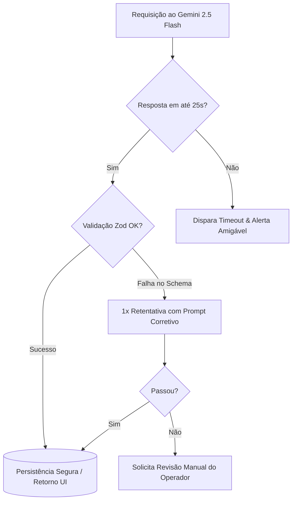

# DIRETRIZES E REGRAS DE INTELIGÊNCIA ARTIFICIAL — MÍDIA.OS (v2.6.0)

> **Documento:** Regras Operacionais, Políticas de Inferência e Governança de IA  
> **Modelo Oficial:** Google Gemini 2.5 Flash (`@google/genai`)  
> **Ambiente:** Produção (Política Ativa de Zero Perda de Dados)  
> **Status:** Ativo e Obrigatório para Todos os Agentes e Pipelines  

---

## 1. PRINCÍPIOS FUNDAMENTAIS DE IA

No Mídia.OS, a Inteligência Artificial é uma **ferramenta de aceleração e assistência operacional**, não uma autoridade contábil ou jurídica isolada. Toda automação baseada em IA deve seguir quatro pilares invioláveis:

1. **Determinismo nas Finanças:** A IA nunca define, arredonda ou liquida valores de PIs ou contratos por conta própria. A matemática financeira e a trava de centavos são executadas exclusivamente por código determinístico no backend (`pi.functions.ts` e `propostas.functions.ts`).
2. **Validação Estrita via Esquema (Schema-First):** Nenhuma informação extraída por modelos generativos é inserida no banco de dados sem passar por validação prévia de esquemas `zod`.
3. **Isolamento de Credenciais:** Chamadas ao Google Gemini ocorrem **estritamente em Server Functions no backend Nitro**. A chave `GEMINI_API_KEY` jamais pode ser exposta no bundle cliente.
4. **Respeito à Política de Zero Perda de Dados:** Sugestões ou mutações acionadas por IA nunca sobrescrevem cadastros existentes de forma destrutiva; operam via criação de novas versões ou preenchimento de campos vazios com aprovação do usuário.

---

## 2. REGRAS PARA PIPELINES DE EXTRAÇÃO AUTÔNOMA

Aplicável a: `midia-kit-ai.functions.ts`, `inventario-gemini.functions.ts`, `pi-ai.functions.ts`, `parceiro-scraper.functions.ts`.

### 2.1 Parâmetros de Inferência
* **Modelo Obrigatório:** `gemini-2.5-flash`
* **Temperatura:** `0.0` a `0.1` (máximo). Inferências para catalogação de dados estruturados devem ser tão determinísticas quanto possível.
* **Modo de Saída:** Formato JSON estruturado com `responseMimeType: "application/json"` e `responseSchema` validado.

### 2.2 Tratamento de Alucinações em Mídia e Coordenadas
* **Geolocalização:** Coordenadas de latitude/longitude extraídas a partir de texto devem ser validadas contra limites geográficos aceitáveis da praça de atuação (ex: Brasil: Latitude entre -33.7 e +5.2; Longitude entre -73.9 e -34.7).
* **Valores de Tabela:** Se o PDF ou mídia kit contiver valores ambíguos ou rasuras, o campo deve ser marcado como `null` ou `pendente_revisao`, forçando a conferência pelo operador humano.
* **Datas e Bi-semanas:** Extrações de calendários de veiculação (bi-semanas OOH) devem seguir rigorosamente o calendário oficial do mercado publicitário vigente.

---

## 3. REGRAS PARA O COPILOTO COMERCIAL E GERAÇÃO ASSISTIDA

Aplicável a: `copiloto-comercial.functions.ts`, `estrategia-ia.functions.ts`, `proposta-apresentacao.functions.ts`, `social-media.functions.ts`.

### 3.1 Parâmetros de Inferência
* **Modelo Obrigatório:** `gemini-2.5-flash`
* **Temperatura:** `0.6` a `0.7` para tarefas de redação persuasiva e geração de argumentos comerciais; `0.2` para simulações de pacotes de mídia.

### 3.2 Tom de Voz e Postura Operacional
* **Tom:** Corporativo, executivo, estratégico e focado em retorno sobre investimento publicitário (ROI/ROAS).
* **Restrição de Alçada de Desconto:** O Copiloto Comercial **não pode prometer ou aprovar descontos superiores a 25%** sem instruir expressamente o executivo de que a proposta exigirá alçada de aprovação da diretoria (`/aprovar-diretoria/$token`).
* **Contextualização Regional:** Ao recomendar pontos de mídia, priorizar sempre o inventário ativo do tenant na praça selecionada (ex: Brasília, Taguatinga, Águas Claras, Plano Piloto, Entorno do DF).

---

## 4. POLÍTICA DE PRIVACIDADE E CONFORMIDADE (LGPD)

1. **Mascaramento de Dados Sensíveis:** Documentos enviados para inferência não devem conter senhas, tokens de autenticação, dados bancários completos (agência/conta) ou dados pessoais de saúde/origem sensível.
2. **Dados de Pessoas Físicas:** No processamento de PIs ou contratos, nomes e CPFs de testemunhas ou sócios devem ser processados apenas para preenchimento dos campos formais, sem serem utilizados para treinamento ou persistência externa.
3. **Retenção de Arquivos Temporários:** Arquivos temporários (PDFs binários ou imagens decodificadas) enviados ao Gemini devem ser descartados da memória da Server Function logo após a conclusão do parsing.

---

## 5. RESILIÊNCIA, RATE LIMITING E TIMEOUTS

* **Timeout Padrão:** Toda requisição à API do Gemini deve possuir timeout máximo de **25 segundos**.
* **Retentativas:** Permitida no máximo **1 retentativa imediata** em caso de falha de parsing JSON.
* **Degradação Elegante:** Em caso de indisponibilidade da API de IA, a aplicação deve manter 100% de sua funcionalidade operacional manual (formulários manuais continuam funcionando normalmente sem bloqueios).

---

*Mídia.OS — Diretrizes e Regras de Inteligência Artificial © 2026.*
