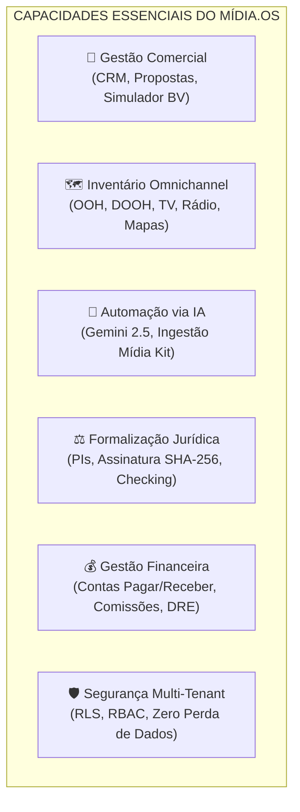
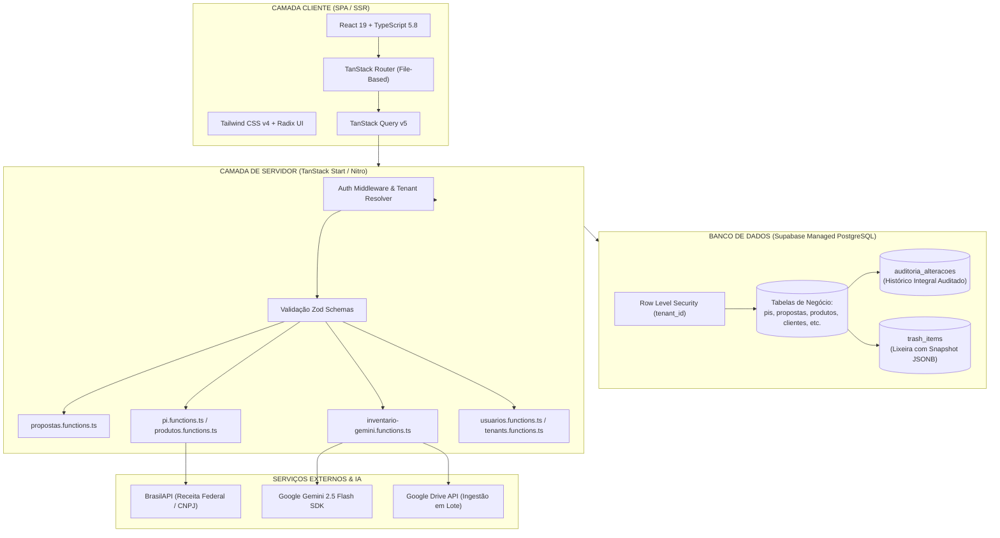
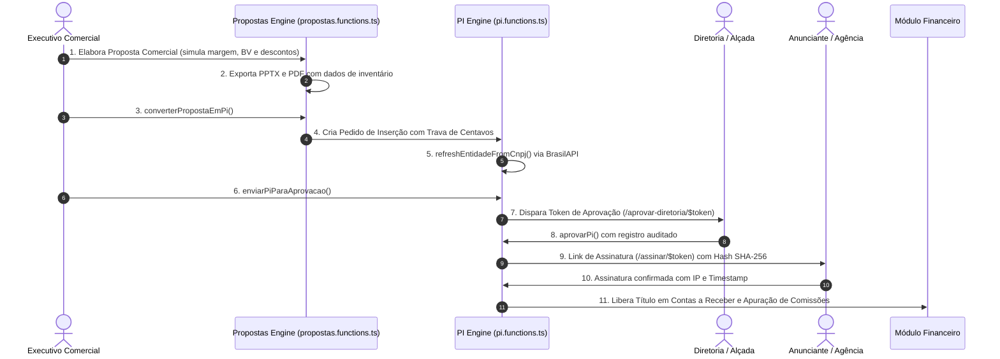

# MAPA DE ARQUITETURA DO SISTEMA — MÍDIA.OS (v2.6.0)

> **Classificação:** Mapa Arquitetural de Engenharia de Software  
> **Versão da Plataforma:** 2.6.0 Enterprise Multi-Tenant  
> **Ambiente:** Produção (Política Ativa de Zero Perda de Dados)  
> **Data de Atualização:** Outubro de 2026  

---

## 1. VISÃO GERAL E CAPACIDADES ESTRATÉGICAS

O **Mídia.OS** é uma plataforma SaaS *Enterprise Omnichannel* e *White-Label* para gestão comercial, inteligência operacional, planejamento e formalização de veículos de comunicação, agências de representação comercial e exibidoras de mídia.



---

## 2. ARQUITETURA DE ROTAS E NAVEGAÇÃO (4 PILARES)

A estrutura canônica de navegação da plataforma organiza-se em 4 pilares:

```
Mídia.OS
 │
 ├── 💼 /comercial               (Geração de Demanda & Negociação)
 │    ├── crm                   → Funil Kanban e gestão de oportunidades comerciais
 │    ├── clientes              → Cadastro de anunciantes e consulta de CNPJ na Receita Federal
 │    └── propostas             → Elaboração, simulação de margens/BV e geração PPTX/PDF
 │
 ├── ⚙️ /operacional             (Inventário, Parceiros & Execução)
 │    ├── produtos              → Catálogo omnichannel, geolocalização e fotos dos pontos
 │    ├── parceiros             → Gestão de veículos parceiros e ingestão via IA / Google Drive
 │    └── pi                    → Pedidos de Inserção, alçadas de aprovação e checking
 │
 ├── 💰 /financeiro              (Faturamento, Liquidação & Remuneração)
 │    ├── financeiro            → Contas a pagar/receber, DRE gerencial e conciliação
 │    └── comissoes             → Apuração de comissões por metas e repasses de agência
 │
 └── 🛡️ /admin                   (Governança, Identidade & Multi-Tenant)
      ├── usuarios              → Gestão de equipe, papéis e matriz de permissões RBAC
      └── configuracoes         → Identidade visual White-Label, integrações e tenant
```

---

## 3. STACK TECNOLÓGICA E FLUXO DE DADOS



---

## 4. MATRIZ DOS MÓDULOS DE SERVIDOR (`src/lib/*.functions.ts`)

Todas as operações de mutação e consulta crítica são protegidas por Server Functions isomorfas (`createServerFn`) com tipagem estrita via `zod`:

| Módulo de Servidor | Arquivo Fonte | Responsabilidade Central | Principais Server Functions |
|---|---|---|---|
| **Comercial / Propostas** | `src/lib/propostas.functions.ts` | Motor de cálculo de planos de mídia, simulação de descontos, comissão e conversão para PI | `listPropostas`<br/>`getProposta`<br/>`upsertProposta`<br/>`converterPropostaEmPi`<br/>`gerarPropostaDoPi` |
| **Operacional / Inventário** | `src/lib/produtos.functions.ts` | Gestão de pontos de mídia (OOH/DOOH), coordenadas geográficas, fotos e reajustes em lote | `listProdutos`<br/>`upsertProduto`<br/>`batchUpdateProdutos`<br/>`importProdutosBulk`<br/>`deleteProduto` |
| **Operacional / Pedidos de Inserção** | `src/lib/pi.functions.ts` | Formalização de PIs com trava de centavos, alçadas de aprovação e conciliação Receita Federal | `listPis`<br/>`getPi`<br/>`upsertPi`<br/>`enviarPiParaAprovacao`<br/>`aprovarPi`<br/>`substituirPi` |
| **Parceiros & Representação** | `src/lib/representacao-comercial.functions.ts` | Cadastro de veículos parceiros e catálogo de mídia unificado | `listPartners`<br/>`upsertPartner`<br/>`listMediaCatalog`<br/>`upsertMediaCatalogItem` |
| **Inteligência Artificial** | `src/lib/inventario-gemini.functions.ts`<br/>`src/lib/midia-kit-ai.functions.ts` | Extração autônoma de inventário a partir de PDFs, mídia kits e planilhas com Gemini 2.5 Flash | `extrairInventarioPDF`<br/>`processarMidiaKit` |
| **Governança & Usuários** | `src/lib/usuarios.functions.ts` | Controle de equipe, perfis de acesso (RBAC) e auditoria de logins | `listUsuarios`<br/>`setUserRole`<br/>`toggleUserAtivo`<br/>`adminResetPassword` |
| **Multi-Tenancy** | `src/lib/tenants.functions.ts` | Gerenciamento de organizações, isolamento de dados e White-Label | `listTenants`<br/>`getOwnerOverview`<br/>`upsertTenant`<br/>`getMyTenantBranding` |

---

## 5. CICLO DE VIDA DO PEDIDO DE INSERÇÃO (PROPOSTA ➔ PI ➔ FATURAMENTO)



---

## 6. SEGURANÇA, AUDITORIA E ZERO PERDA DE DADOS

O sistema opera sob as diretrizes de produção documentadas em `AGENTS.md`:

1. **Row Level Security (RLS) Inviolável:**
   - Toda consulta no banco aplica `tenant_id = auth.jwt() ->> 'tenant_id'`.
   - Isolamento garantido no PostgreSQL, prevenindo vazamento de dados entre empresas.

2. **Auditoria Contínua (`auditoria_alteracoes`):**
   - Gatilhos automáticos registram `INSERT`, `UPDATE` e `DELETE` em tabelas críticas (`pis`, `propostas`, `clientes`, `produtos`).
   - Armazena estado anterior e novo em JSONB, usuário autor e timestamp.

3. **Lixeira Segura com Restauração (`trash_items`):**
   - Nenhuma exclusão definitiva é permitida diretamente pelo usuário comum.
   - O registro é marcado como inativo e um snapshot JSONB completo é gerado para restauração imediata.

---

## 7. MATRIZ DE PAPÉIS E PERMISSÕES (RBAC)

| Papel | Comercial (`/comercial`) | Operacional (`/operacional`) | Financeiro (`/financeiro`) | Admin (`/admin`) |
|---|:---:|:---:|:---:|:---:|
| `master_admin` | Total | Total | Total | Total + Painel Owner |
| `admin` | Total | Total | Total | Gestão do Tenant |
| `diretor` | Aprovação/Descontos | Consulta/Aprovação PI | DRE / Comissões | Consulta |
| `financeiro` | Leitura | Faturamento de PIs | Total | - |
| `executivo` | Total (CRM/Propostas) | Consulta Produtos/PIs | Apenas suas comissões | - |
| `operacional` | Leitura | Gestão de Produtos/Checkings | - | - |
| `instalador` | - | Visualização O.S. e Checking | - | - |

---

*Mídia.OS — Documento Arquitetural Oficial © 2026.*
