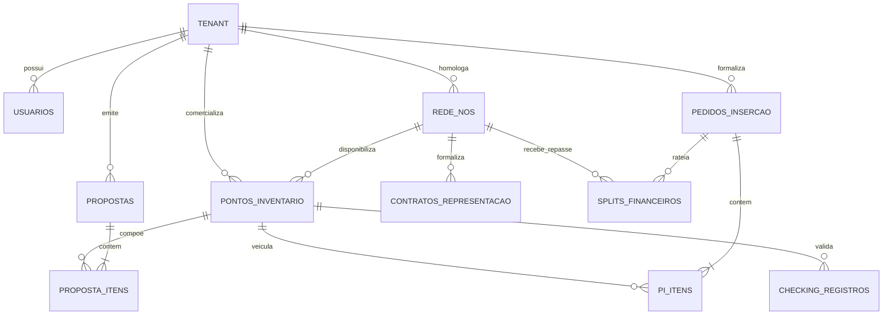
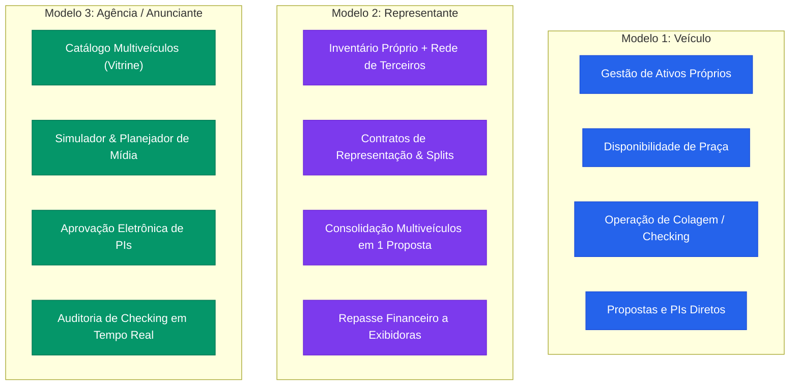
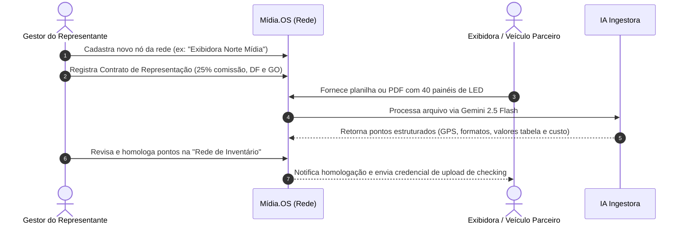
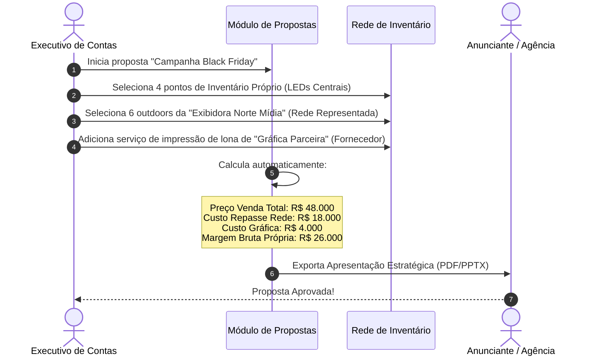
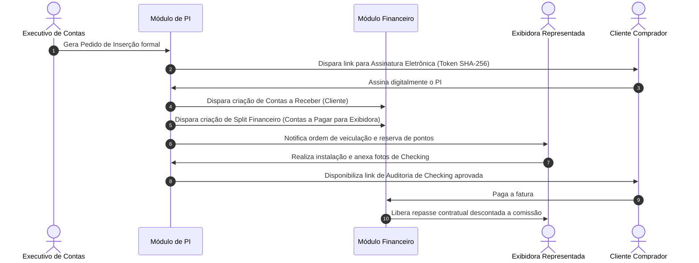
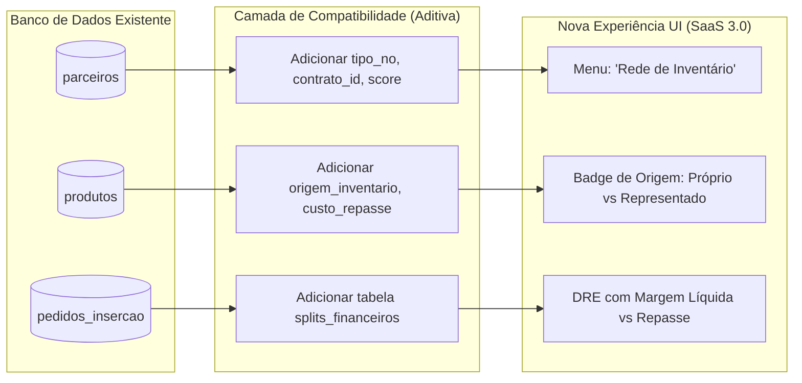

# REESTRUTURAÇÃO DO MODELO DE NEGÓCIO — MÍDIA.OS 3.0
## Documento Arquitetural: Modelo "Rede de Inventário" & Inquilinos Especializados

> **Versão:** 3.0-Concept  
> **Status:** Arquitetura Conceitual Aprovada  
> **Data:** Outubro de 2026  
> **Regra Mandatória:** Não altera código existente. Especificação conceitual para evolução incremental sem risco à produção.

---

## 1. VISÃO GERAL & OBJETIVO DA REESTRUTURAÇÃO

O **Mídia.OS** foi concebido originalmente como uma solução híbrida de gestão de mídia externa (OOH/DOOH) e comercialização publicitária. À medida que o produto avança para a maturidade de **SaaS Enterprise**, identifica-se uma limitação crucial no modelo atual:

> ⚠️ **A Limitação Atual:**  
> A entidade `parceiros` tratava indistintamente veículos terceirizados, fornecedores de impressão e agências como simples "Parceiros de Mídia". Essa modelagem não reflete com fidelidade a complexidade contratual, a segregação de responsabilidades financeiras (splits de receita, custos de repasse) e a variedade operacional do mercado publicitário brasileiro.

A nova arquitetura introduz:
1. **Tipificação de Inquilinos (Tenants):** Diferentes tipos de clientes que assinam o SaaS, adaptando a experiência, o vocabulário e os módulos ativos ao seu modelo operacional real.
2. **Conceito Unificado de "Rede de Inventário":** Substitui a noção restritiva de "Parceiro de Mídia" por uma topologia hierárquica e modular que organiza **Inventário Próprio** e **Inventário Representado** (Veículos Parceiros, Exibidoras e Fornecedores).

```
                              ┌────────────────────────────────────────┐
                              │            MÍDIA.OS (SaaS)             │
                              └───────────────────┬────────────────────┘
                                                  │
                ┌─────────────────────────────────┼─────────────────────────────────┐
                ▼                                 ▼                                 ▼
      ╔═══════════════════════╗         ╔═══════════════════════╗         ╔═══════════════════════╗
      ║       MODELO 1        ║         ║       MODELO 2        ║         ║       MODELO 3        ║
      ║ Veículo de Comunicação║         ║ Representante de Mídia║         ║  Agência / Anunciante ║
      ╚══════════════╤════════╝         ╚═══════════╤═══════════╝         ╚═══════════╤═══════════╝
                     │                              │                                 │
                     ▼                              ▼                                 ▼
         [ Inventário Próprio ]       ┌─────────────┴─────────────┐          [ Painel Comprador ]
                                      ▼                           ▼          - Planejamento de Mídia
                                 [ Próprio ]               [ Representado ]   - Aprovação de PIs
                                                                  │          - Checking Online
                                          ┌───────────────────────┼───────────────────────┐
                                          ▼                       ▼                       ▼
                                  [Veículo Parceiro]         [Exibidora]            [Fornecedor]
```

---

## 2. OS TRÊS MODELOS DE INQUILINOS (TENANTS)

Cada empresa cliente do Mídia.OS opera sob uma configuração de inquilino (`tenant_tipo_modelo`), determinando suas regras de negócio, fluxos de precificação e interface de usuário:

| Característica | MODELO 1: Veículo de Comunicação | MODELO 2: Representante de Mídia | MODELO 3: Agência / Anunciante |
| :--- | :--- | :--- | :--- |
| **Público-Alvo** | Emissoras de TV, Rádios, Painéis LED proprietários, Mobiliário Urbano. | Comercializadoras multiveículos, Representantes regionais (ex: Nexo Mídia). | Agências de publicidade, Departamentos de marketing corporativo. |
| **Composição de Inventário** | **100% Próprio** | **Híbrido:** Próprio + Rede Representada | **Zero Inventário Próprio** (Consumo / Compra) |
| **Margem / Monetização** | Preço Bruto / Desconto / Tabela própria | Margem de representação (Comissão %, Split ou Mark-up) | Honorários, BV de agência, Economia negociada |
| **Papel nos PIs** | Emissor de PI para Agência/Cliente | Emissor de PI consolidado ou Intermediador | Receptor / Aprovador de PIs de Veículos |
| **Operação de Campo** | Equipe própria de colagem, instalação e checking | Equipe mista ou homologação de checking do parceiro | Monitoramento e validação de veiculação |
| **Módulos Primários** | Inventário, Circuitos, Disponibilidade, Propostas, Faturamento | Rede de Inventário, Propostas Multiveículo, Splits, PIs | Planejador de Mídia, Comparador de Pontos, Checking |

---

## 3. CONCEITO: A NOVA "REDE DE INVENTÁRIO"

A **Rede de Inventário** unifica toda a malha de ativos publicitários sob a gestão do inquilino em uma hierarquia de dois grandes troncos:

```
Rede de Inventário
│
├── 1. Inventário Próprio
│     ├── Ativos 100% de propriedade do inquilino
│     ├── Margem comercial direta
│     ├── Manutenção, colagem e checking operacional internos
│     └── Gestão de disponibilidade imediata
│
└── 2. Inventário Representado
      │
      ├── 2.1 Veículo Parceiro (TV, Rádio, Portais de Notícias, Jornais, Mídia Urbana)
      │     ├── Grade de horários, spots, impressões ou diárias
      │     ├── Política de comissão de representação comercial (ex: 15% a 30%)
      │     └── Reserva de espaço sob confirmação de alçada
      │
      ├── 2.2 Exibidora (Empresas locais de Outdoor, Painéis LED, Empenas, Busdoor)
      │     ├── Pontos geolocalizados em cidades/estados onde o inquilino não possui estrutura física
      │     ├── Tabela de custo líquido (repasse) vs Tabela de venda comercial
      │     └── SLA de bi-semana, instalação e foto de checking
      │
      └── 2.3 Fornecedor (Parceiros Técnicos e Operacionais)
            ├── Gráficas de lona e papel OOH
            ├── Produtoras de áudio/vídeo e adaptações criativas
            └── Empresas terceirizadas de instalação física e fiscalização de rua
```

### 3.1 Benefícios Conceituais da Mudança:
1. **Fim da Ambiguidade:** Deixa claro quando um ponto é do próprio inquilino (lucro bruto integral) e quando há custo de repasse a terceiros (split de receita).
2. **Circuitos Multiveículos:** Permite que uma única proposta comercial agrupe 5 pontos próprios, 3 pontos de uma exibidora parceira e o custo de produção de um fornecedor homologado.
3. **Contratos de Representação:** Estabelece prazos de vigência, praças de exclusividade e percentuais de remuneração transparentes entre o representante e os veículos.

---

## 4. MODELO DE DADOS & ENTIDADES CONCEITUAIS

Abaixo detalham-se as entidades conceituais que consolidam a **Rede de Inventário** e os **Inquilinos**:



### 4.1 Entidade: `tenants` (Inquilinos do Sistema)
Representa a conta do cliente que assina o Mídia.OS.
- `id`: UUID (Primary Key)
- `razao_social` / `nome_fantasia`: String
- `documento_fiscal`: String (CNPJ)
- `tipo_modelo`: ENUM (`VEICULO`, `REPRESENTANTE`, `AGENCIA_ANUNCIANTE`)
  - `VEICULO`: Habilita apenas Inventário Próprio e operação direta.
  - `REPRESENTANTE`: Habilita Inventário Próprio + Rede de Inventário Representado + Splits.
  - `AGENCIA_ANUNCIANTE`: Transforma a interface em ferramenta de planejamento, compra e validação de checking.
- `configuracoes_comerciais`: JSONB (limites de alçada, margem padrão, moeda, dados bancários).

### 4.2 Entidade: `rede_inventario_nos` (Substitui conceitualmente `parceiros`)
Representa cada participante que integra a rede de inventário do inquilino.
- `id`: UUID (Primary Key)
- `tenant_id`: UUID (Foreign Key)
- `razao_social` / `nome_fantasia`: String
- `tipo_no`: ENUM:
  - `PROPRIO` (representação interna da própria operação)
  - `VEICULO_PARCEIRO` (TV, rádio, impresso, digital)
  - `EXIBIDORA` (operadora física de OOH/DOOH)
  - `FORNECEDOR` (gráfica, montagem, iluminação, criativo)
- `dados_contato`: JSONB (comercial, operacional/checking, financeiro)
- `praças_cobertura`: Array de Strings (Cidades/Estados atendidos)
- `status_homologacao`: ENUM (`EM_ANALISE`, `ATIVO`, `BLOQUEADO`, `INATIVO`)
- `score_confiabilidade`: Decimal (baseado no histórico de cumprimento de prazos de checking)

### 4.3 Entidade: `contratos_representacao`
Regula as condições comerciais entre o Inquilino (Representante) e o Nó da Rede (Veículo/Exibidora).
- `id`: UUID (Primary Key)
- `tenant_id`: UUID
- `rede_no_id`: UUID (Referência a `rede_inventario_nos`)
- `numero_contrato`: String
- `vigencia_inicio` / `vigencia_fim`: Date
- `tipo_remuneracao`: ENUM:
  - `COMISSAO_PERCENTUAL` (ex: 20% sobre o valor bruto faturado)
  - `CUSTO_LIQUIDO_FIXO` (repasse de valor fixo por bi-semana/mês; o representante precifica livremente)
  - `SPLIT_AUTOMATICO` (faturamento direto pelo veículo com repasse de rep fee à comercializadora)
- `alçada_desconto_maxima`: Decimal (desconto máximo que o representante pode aplicar sem aprovação prévia)
- `exclusividade_territorial`: Boolean
- `documento_anexo_url`: String

### 4.4 Entidade: `produtos` / `pontos_inventario` (Evolução)
Cada espaço publicitário cadastrado no catálogo.
- `id`: UUID (Primary Key)
- `tenant_id`: UUID
- `origem_inventario`: ENUM (`PROPRIO`, `REPRESENTADO`)
- `rede_no_id`: UUID (Nullable se `PROPRIO`, obrigatório se `REPRESENTADO`)
- `tipo_midia`: ENUM (`OUTDOOR`, `PAINEL_LED`, `FRONT_LIGHT`, `ABRIGO_ONIBUS`, `RADIO`, `TV`, `DIGITAL`, etc.)
- `preco_tabela`: Decimal (Valor de face do espaço)
- `custo_repasse_parceiro`: Decimal (Valor devido ao dono do ponto em caso de venda)
- `margem_minima_percentual`: Decimal
- `latitude` / `longitude` / `endereco_completo`: Dados de geolocalização
- `especificacoes_tecnicas`: JSONB (dimensão, resolução, formato, loops, inserções/hora)
- `fotos_galeria`: Array de URLs

### 4.5 Entidade: `splits_financeiros` (Rateio Comercial)
Registra o desdobramento financeiro de cada item do Pedido de Inserção faturado.
- `id`: UUID (Primary Key)
- `tenant_id`: UUID
- `pi_id`: UUID (Referência a `pedidos_insercao`)
- `pi_item_id`: UUID
- `rede_no_id`: UUID (Quem recebe o repasse)
- `valor_bruto_item`: Decimal
- `valor_comissao_representante`: Decimal
- `valor_repasse_parceiro`: Decimal
- `status_repasse`: ENUM (`AGUARDANDO_PAGAMENTO_CLIENTE`, `LIBERADO_PARA_PAGAMENTO`, `PAGO`, `CANCELADO`)
- `data_prevista_repasse`: Date

---

## 5. MATRIZ DE PERMISSÕES (RBAC MULTI-INQUILINO)

A matriz de segurança opera em duas camadas: **Tipo de Inquilino** e **Perfil do Usuário**.

### 5.1 Permissões por Tipo de Inquilino



| Módulo / Funcionalidade | Modelo 1: Veículo | Modelo 2: Representante | Modelo 3: Agência/Anunciante |
| :--- | :---: | :---: | :---: |
| **Cadastrar Inventário Próprio** | ✅ Sim | ✅ Sim | ❌ Não |
| **Cadastrar Nós da Rede (Exibidoras/Veículos)** | ❌ Não | ✅ Sim | ❌ Não (Apenas consulta homologados) |
| **Definir Regras de Split e Custos de Repasse** | ❌ Não | ✅ Sim | ❌ Não (Vê apenas preço final negociado) |
| **Emitir Propostas Comerciais** | ✅ Sim | ✅ Sim | ❌ Não (Monta "Planos de Mídia") |
| **Emitir Pedidos de Inserção (PI)** | ✅ Sim | ✅ Sim | ❌ Não (Recebe para assinatura) |
| **Assinar / Aprovar PIs Eletronicamente** | ❌ (Emite) | ❌ (Emite) | ✅ Sim |
| **Fazer Upload de Fotos de Checking** | ✅ Sim | ✅ Sim (ou nó da rede) | ❌ Não |
| **Consultar Relatório de Checking de Rua** | ✅ Sim | ✅ Sim | ✅ Sim (Auditoria visual das suas marcas) |
| **Acesso a DRE e Lucratividade do Veículo** | ✅ Sim | ✅ Sim (Com visão de margem líquida) | ❌ Não |

### 5.2 Perfis de Acesso dos Usuários

1. **Super Administrador do Tenant:** Configura dados corporativos, ativa/desativa nós da rede e aprova alçadas financeiras de contratos.
2. **Executivo de Vendas (Comercial):** Cria planos e propostas; visualiza preços de tabela e descontos autorizados; não visualiza margem interna de repasse se restrito pela diretoria.
3. **Gestor Operacional (Tráfego & Checking):** Administra bi-semanas, atribui instaladores, cobra materiais gráficos de fornecedores e valida fotos de checking.
4. **Financeiro:** Conciliação bancária, emissão de faturas, liberação de comissões de executivos e liquidação de repasses para a rede representada.
5. **Acesso Externo — Portal do Parceiro da Rede (Exibidora/Veículo):**
   - Usuário convidado restrito aos seus próprios pontos;
   - Recebe notificações de reservas confirmadas;
   - Realiza upload de relatórios fotográficos de checking diretamente no sistema;
   - Acompanha extrato de repasses financeiros devidos.

---

## 6. FLUXOS OPERACIONAIS E COMERCIAIS END-TO-END

### Fluxo 1: Onboarding e Homologação na Rede de Inventário (Modelo 2)



### Fluxo 2: Criação de Proposta Multi-Origem (Inventário Próprio + Rede)



### Fluxo 3: Fechamento de PI, Split Financeiro e Checking



---

## 7. IMPACTO NO SISTEMA ATUAL & ESTRATÉGIA DE TRANSIÇÃO

A transição deve respeitar rigorosamente a diretriz: **Zero Perda de Dados e Compatibilidade Retroativa**. Nenhuma alteração destrutiva será aplicada ao banco de dados existente.

### 7.1 Mapeamento de Mudanças por Camada



### 7.2 Análise de Impacto Detalhada

| Componente / Módulo | Estrutura Atual | Nova Estrutura Conceitual | Nível de Impacto | Estratégia de Mitigação |
| :--- | :--- | :--- | :--- | :--- |
| **Tabela `organizacoes` (Tenants)** | Não possui distinção explícita de modelo de negócio. | Campo `tipo_modelo` (`VEICULO`, `REPRESENTANTE`, `AGENCIA_ANUNCIANTE`). | **Baixo** | Inserir coluna com default `'REPRESENTANTE'`, garantindo que todos os clientes atuais mantenham acesso completo a todas as funções. |
| **Tabela `parceiros`** | Armazena veículos e agências misturados. | Evolui conceitualmente para `rede_inventario_nos`. | **Médio** | Manter o nome físico da tabela `parceiros`. Adicionar colunas `tipo_no` e `score_confiabilidade`. Criar view relacional se necessário. |
| **Tabela `produtos`** | Campo `parceiro_id` opcional. Preço único de tabela. | `origem_inventario` (`PROPRIO` / `REPRESENTADO`), `custo_repasse_parceiro`, `margem_minima`. | **Baixo** | Colunas novas opcionais (`NULLABLE`). Se `parceiro_id IS NULL`, assume-se `origem_inventario = 'PROPRIO'`. Compatibilidade 100%. |
| **Propostas e PIs** | Calculam valor líquido comercial apenas com desconto do cliente. | Registram o custo de repasse por item e geram registros na tabela `splits_financeiros`. | **Médio** | Manter o cálculo atual de `valor_liquido`. Adicionar cálculo complementar de `margem_liquida_pos_repasse` sem quebrar o total do cliente. |
| **Interface / Menu Lateral** | Rota `/parceiros` com título "Parceiros de Mídia". | Renomear o título visual para **"Rede de Inventário"** com abas: *Inventário Próprio*, *Veículos Parceiros*, *Exibidoras* e *Fornecedores*. | **Baixo** | Preserva a rota física `/parceiros` sem quebrar URLs e bookmarks já utilizados pelos clientes. |

---

## 8. PLANO DE ADOÇÃO CONCEITUAL POR ETAPAS

Para garantir que a evolução ocorra de forma fluida e segura, a reestruturação conceitual foi dividida em quatro fases bem delineadas:

### Fase 1: Semântica & Enriquecimento de Esquema (Não-Bloqueante)
- Adicionar colunas de apoio na tabela `parceiros` (`tipo_no`) e `produtos` (`origem_inventario`, `custo_repasse_parceiro`).
- Popular dados históricos automaticamente:
  - Produtos sem parceiro associado recebem `origem_inventario = 'PROPRIO'`.
  - Produtos com parceiro associado recebem `origem_inventario = 'REPRESENTADO'`.

### Fase 2: Ajuste de Interface (Apresentação Visual)
- No módulo de produtos, adicionar badge visual:
  - 🟢 **Inventário Próprio** (identificado pelo logo ou cor institucional do tenant).
  - 🔵 **Rede Representada: [Nome da Exibidora/Veículo]**.
- Na rota `/parceiros`, atualizar os textos e cabeçalhos para **"Rede de Inventário"**, estruturando filtros rápidos por tipo de nó (Veículo, Exibidora, Fornecedor).

### Fase 3: Motor Financeiro de Splits & Repasses
- Criação da tabela `splits_financeiros` ligada ao PI.
- Adição da visualização de repasse pendente para veículos terceirizados no módulo financeiro (Contas a Pagar / Repasses da Rede).

### Fase 4: Especialização por Modelo de Inquilino
- Aplicação de regras no frontend para ocultar abas irrelevantes com base no `tipo_modelo` do tenant:
  - Inquilino **Veículo**: Oculta abas de repasse e terceirização.
  - Inquilino **Representante**: Mantém visão 360° completa.
  - Inquilino **Agência/Anunciante**: Habilita o portal de compra de mídia e auditoria de checking.

---

## 9. CONCLUSÃO E VALOR ESTRATÉGICO

A reestruturação conceitual da **Rede de Inventário** eleva o Mídia.OS ao patamar das grandes plataformas mundiais de tecnologia de mídia (AdTech & Media ERP).

Ao reconhecer e modelar fielmente:
1. Os **três perfis reais de operação** (Veículo, Representante e Agência);
2. A distinção clara entre **ativos próprios** e **ativos de terceiros**;
3. O rateio financeiro automatizado (**splits e repasses**);

O sistema elimina atritos comerciais, previne erros de faturamento e prepara a arquitetura para atender desde pequenas exibidoras locais até gigantescas comercializadoras de abrangência nacional.
