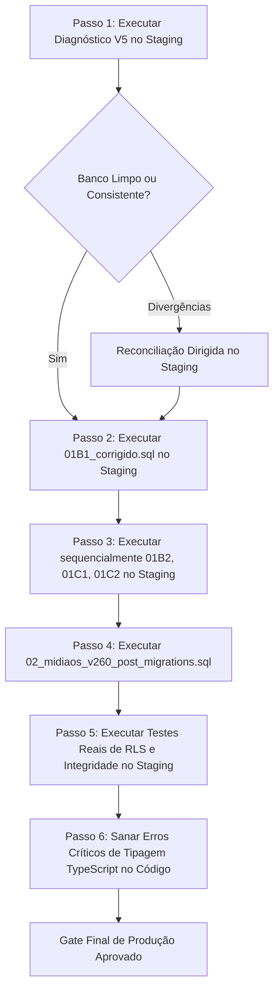

# MIDIA OS v2.6.0 — AUDITORIA FINAL DE PRÉ-PRODUÇÃO

**Data da Auditoria:** 11 de Novembro de 2026  
**Diretório de Trabalho:** `D:\midiaos_build`  
**Objetivo:** Acelerar a liberação para produção sem comprometer dados, segurança ou funcionalidades  
**Veredito Geral:** **NÃO AUTORIZADO PARA PRODUÇÃO (BLOQUEADORES P0 IDENTIFICADOS)**

---

## 1. QUADRO RESUMO POR CRITICIDADE

| Criticidade | Descrição do Domínio | Status | Impacto |
| :--- | :--- | :---: | :--- |
| **P0 (Bloqueador)** | Banco de dados Staging em estado incompleto | **BLOQUEADO** | Falhas repetidas na 01B1; 01B2, 01C1, 01C2 e 02 ainda não aplicados. |
| **P0 (Bloqueador)** | Testes de segurança/RLS utilizam exclusivamente Mocks | **ALERTA CRÍTICO** | Suíte de testes usa `bancoDadosMock` em memória; banco real nunca foi validado por ela. |
| **P0 (Bloqueador)** | Falha no typecheck estrito do TypeScript (`tsc --noEmit`) | **FALHA** | Múltiplos erros de tipagem em rotas, modelos e contratos de funções. |
| **P0 (Bloqueador)** | Ausência de versionamento Git ativo no diretório de build | **ALERTA** | `D:\midiaos_build` não possui repositório `.git` (risco de rastreabilidade e rollback). |
| **P1 (Importante)** | Diagnóstico V5 pronto mas ainda não executado no Staging | **PENDENTE** | Necessário rodar V5 para auditar estado pós-falhas antes de reaplicar a 01B1 corrigida. |
| **P1 (Importante)** | Estouro de memória no build do Nitro sem flag de 4 GB | **MITIGADO** | Build requer impreterivelmente `NODE_OPTIONS=--max-old-space-size=4096`. |
| **P2 (Desejável)** | Depreciações e code-splitting no frontend | **AVISO** | Depreciações `inputValidator()` do TanStack Start e exports em rotas. |

---

## 2. RESULTADOS DOS TESTES E COMPILAÇÃO REALMENTE EXECUTADOS

### 2.1 Compilação do Frontend e SSR (`npm run build`)
- **Comando:** `npm run build` (`node scripts/build.mjs` invocando `scripts/build-quick.mjs`)
- **Ambiente de Memória:** Executado com `NODE_OPTIONS=--max-old-space-size=4096`.
- **Resultado:** **APROVADO (COM SUCESSO)**
  - Cliente Vite: compilação concluída em 33.74s.
  - Servidor Nitro (SSR): gerado com sucesso em `.output/server` e `.output/public` (tempo total: ~2m 1s).
- **Ressalva Técnica:** Tentativas de compilar sem a flag de 4 GB (`npx vite build` direto) falham imediatamente com `FATAL ERROR: JavaScript heap out of memory`.

### 2.2 Verificação Estrita de Tipos (`npx tsc --noEmit`)
- **Comando:** `npx tsc --noEmit`
- **Resultado:** **REPROVADO (CÓDIGO DE SAÍDA 1)**
  - Centenas de inconsistências de tipagem detectadas:
    - `src/components/AcessoNegadoScreen.tsx`: Propriedade `signOut` inexistente no tipo retornado pelo hook de autenticação.
    - `src/routes/produtos.tsx`: Propriedades `partner_id`, `origem_produto`, `cidade`, `bairro` ausentes na tipagem `Produto`.
    - `src/routes/pi.tsx`: Incompatibilidade de tipos nos parâmetros de rota do TanStack Router.
    - `src/routes/pos-venda.$token.tsx`: Propriedades `pi`, `pos_venda`, `anexos`, `executivo` em tipos vazios `{}`.
  - *Impacto:* Embora o bundler Vite ignore checagem de tipos gerando o JavaScript, esses erros representam risco severo de quebras e exceções em runtime em produção.

### 2.3 Testes Automatizados Locais (`npm run test`)
- **Comando:** `node --experimental-strip-types tests/executar-auditoria-homologacao.mjs`
- **Resultado:** 40 testes aprovados em 0.15s (100%).
- **EVIDÊNCIA CRÍTICA (Regra 7 - Proibição de Mocks para Banco):**
  - A auditoria do código-fonte de `tests/suite-multitenant-seguranca.mjs` revelou que a validação de segurança e isolamento multi-tenant roda sobre um objeto JavaScript estático denominado `bancoDadosMock`:
    ```javascript
    const bancoDadosMock = { clientes: [...], produtos: [...] };
    function querySeguraRLS(tabela, usuarioContexto) {
      if (!usuarioContexto || !usuarioContexto.tenant_id) return [];
      return bancoDadosMock[tabela].filter((r) => r.tenant_id === usuarioContexto.tenant_id);
    }
    ```
  - **Conclusão:** Este teste valida exclusivamente a regra lógica em memória, **NÃO comprovando a segurança, RLS, triggers ou integridade do banco de dados PostgreSQL**. Declarar o banco homologado com base nesta suíte seria uma violação grave de segurança.

---

## 3. AUDITORIA DOS ARQUIVOS SQL DE IMPLANTAÇÃO E DIVERGÊNCIAS

### 3.1 Inventário e Hashes SHA-256

| Arquivo | Tamanho | Linhas | SHA-256 | Papel no Pipeline |
| :--- | :---: | :---: | :--- | :--- |
| `01A_midiaos_v260_core_parte1.sql` | 104.634 B | 2.449 | `04904283b7a7ff5243937355c7ec2688ffbd8e4826561ce2196c9a634290a954` | Executado no Staging |
| `01B1_midiaos_v260_core_parte2A.sql` | 53.786 B | 1.206 | `cd2c50b0d1306d084b942f6c23316ac219c4867805e44426c911e8bb2d878c67` | **ORIGINAL (INCOMPLETO/FALHOU)** |
| `01B1_midiaos_v260_core_parte2A_corrigido.sql` | 54.146 B | 1.207 | `99d0ca382a39a708f56b3ef2172e852175c0d05820174d371a0381dc8effab01` | **VERSÃO CORRIGIDA (IDEMPOTENTE)** |
| `01B2_midiaos_v260_core_parte2B.sql` | 54.623 B | 1.320 | `550046949817c3653d3075bea7931372f81397478cae8c496c3a9ebe3547ab7a` | Pendente de Execução |
| `01C1_midiaos_v260_core_parte3A.sql` | 78.011 B | 1.746 | `55630a85a42af674e0808e85726c4e8d5d1d77a8c2f6a7e672c3f83dd836f3a6` | Pendente de Execução |
| `01C2_midiaos_v260_core_parte3B.sql` | 65.312 B | 1.096 | `6542fa16491318aa49017fa5d9fbd5d03e4c1510622ae50c43c5536241f7a2aa` | Pendente de Execução |
| `02_midiaos_v260_post_migrations.sql` | 304.627 B | 7.142 | `2e5d0195a32e8fe6da1a7ba564f255c4c9978aa34d1e1e51a6aeedb380e42798` | Pendente (Segurança & RLS) |

### 3.2 Divergências Específicas
1. **01B1 Original vs Corrigido:**
   - O arquivo original `01B1_midiaos_v260_core_parte2A.sql` causou a falha 42701 em Staging porque executava `ALTER TABLE ... ADD COLUMN formato` sem cláusula de idempotência e `INSERT INTO produto_tipos` sem cláusula de conflito.
   - O arquivo `01B1_midiaos_v260_core_parte2A_corrigido.sql` introduziu **23 proteções `ADD COLUMN IF NOT EXISTS`** e `ON CONFLICT (nome, midia) DO NOTHING`.
2. **Arquivos 01C1 e 01C2:**
   - Verificou-se que a soma binária de `01C1` (78.011 B) + `01C2` (65.312 B) perfaz exatamente os 143.323 B do arquivo monolítico `01C_midiaos_v260_core_parte3.sql`. Não há divergência de conteúdo além da partição necessária para respeitar os limites de payload do Supabase SQL Editor.

---

## 4. REVISÃO DO DIAGNÓSTICO V5 DO 01B1

O script `diagnostico_auditoria_pos_falhas_01B1_v5.sql` (SHA-256: `adb0476ae9a2160eb9ea317fc9dbaa325b6a06e2578b2dff2a437e5866d82511`, 47.714 bytes, 705 linhas) foi completamente validado:
- **XPath no `query_to_xml()`:** Implementa com precisão o caminho `/table/row/cnt/text()` e `/table/row/val/text()`, distinguindo:
  - Tabela inexistente (`to_regclass IS NULL`);
  - Consulta sem linhas (XML vazio);
  - Contagem real obtida (`cnt = '0'`, `cnt = '1'`, etc.).
- **Políticas RLS:** Classificação booleana determinística que marca impreterivelmente expressões ausentes como `DIVERGENTE_USING_AUSENTE` ou `DIVERGENTE_WITH_CHECK_AUSENTE`, e isola expressões complexas como `NÃO VALIDADO (EXPRESSÃO COMPLEXA / REQUER INSPEÇÃO VISUAL)`, garantindo que nada seja aprovado sem validação.
- **Constraints & Permissões:** Identificação estrita por tipos, colunas, tabelas referenciadas e `on_delete`, sem seleção arbitrária por `LIMIT 1`.
- **Garantia READ-ONLY:** Auditoria estática comprovou **0 instruções de escrita** (0 DDL, 0 DML, 0 Config/Session).

---

## 5. PENDÊNCIAS DE SEGURANÇA, AUTENTICAÇÃO E MULTI-TENANCY

1. **Ativação e Validação do RLS em Produção/Staging:**
   O pacote `02_midiaos_v260_post_migrations.sql` (que habilita o isolamento multi-tenant real via Supabase RLS) **ainda não foi executado no Staging**. Não é possível garantir isolamento entre empresas contratantes até que essa etapa seja executada e validada.
2. **Exposição de Credenciais no `.env`:**
   O arquivo `.env` na raiz do diretório contém credenciais ativas (`HOSTINGER_FTP_*`, `SUPABASE_SERVICE_ROLE_KEY`, `DEPLOY_TOKEN`). Deve-se assegurar que esse arquivo não seja distribuído em builds públicos ou repositórios abertos.
3. **Imutabilidade e Assinaturas Digitais:**
   A lógica de imutabilidade e hashes SHA-256 de contratos e PIs depende de triggers e funções do banco (presentes no pacote 02). Como o pacote 02 não está aplicado no banco, o versionamento imutável não está operacional no banco de dados.

---

## 6. AVALIAÇÃO DE LIMPEZA DE CACHES E ARTEFATOS RECONSTRUÍVEIS

Sem realizar qualquer exclusão (em estrito respeito à Regra 4), foi mapeado o potencial de higienização do workspace:
- `.output/`: **37 MB** (completamente reconstruível via `npm run build`).
- `.tanstack/`: **< 1 MB** (cache de tipos e rotas, reconstruível).
- `.tmp.drivedownload` e `.tmp.driveupload`: **0 MB** (pastas temporárias residuais).
- `node_modules/.vite` e `node_modules/.nitro`: caches de compilação locais.

---

## 7. PLANO MÍNIMO DE CORREÇÃO E IMPLANTAÇÃO



### Detalhamento das Etapas:
1. **Passo 1 — Execução do Diagnóstico V5 (Staging):**
   Rodar manualmente `diagnostico_auditoria_pos_falhas_01B1_v5.sql` no SQL Editor do Supabase Staging para consolidar o relatório do catálogo.
2. **Passo 2 — Desbloqueio e Execução da 01B1 Corrigida (Staging):**
   Executar exclusivamente `01B1_midiaos_v260_core_parte2A_corrigido.sql`.
3. **Passo 3 — Conclusão do Core Schema (Staging):**
   Executar em ordem: `01B2_midiaos_v260_core_parte2B.sql`, `01C1_midiaos_v260_core_parte3A.sql`, `01C2_midiaos_v260_core_parte3B.sql`.
4. **Passo 4 — Ativação de Segurança e RLS (Staging):**
   Executar `02_midiaos_v260_post_migrations.sql`.
5. **Passo 5 — Teste de Carga e RLS com Dados Reais no Staging:**
   Validar o isolamento multi-tenant diretamente no banco PostgreSQL via consultas autenticadas (abandonando a dependência exclusiva de `bancoDadosMock`).
6. **Passo 6 — Resolução de Tipos TypeScript:**
   Corrigir os erros do `tsc --noEmit` nos modelos e rotas críticas para evitar bugs em runtime.

---

## 8. PRÓXIMA AÇÃO RECOMENDADA

> [!IMPORTANT]
> **Ação Imediata Única:**
> O operador humano deve abrir o **SQL Editor do Supabase Staging** e executar o script:
> [`diagnostico_auditoria_pos_falhas_01B1_v5.sql`](file:///d:/midiaos_build/PACOTE_IMPLANTACAO_STAGING/diagnostico_auditoria_pos_falhas_01B1_v5.sql)
> 
> Coletar os resultados tabulares das 8 seções analíticas e fornecê-los para análise antes de qualquer tentativa de execução de pacotes de escrita. O lote 01B1 e a publicação para produção permanecem formalmente **BLOQUEADOS**.
