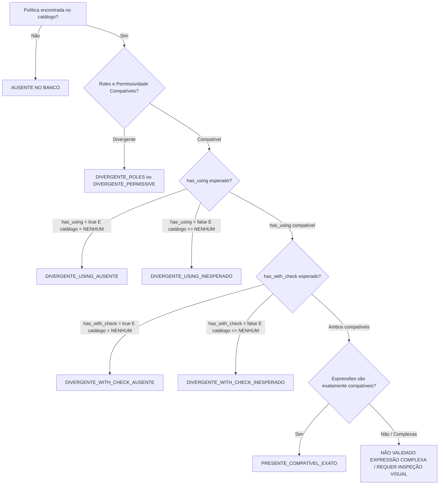

# MIDIA OS v2.6.0 — RELATÓRIO DE REVISÃO E ENTREGA DO DIAGNÓSTICO PÓS-FALHAS V5

**Data:** 11 de Novembro de 2026  
**Ambiente:** Supabase Staging (PostgreSQL 17.11)  
**Objetivo:** Auditoria READ-ONLY pós-falhas do lote 01B1  
**Status do Lote 01B1:** **BLOQUEADO** (Aguardando execução do diagnóstico V5 e deliberação)

---

## 1. RESUMO EXECUTIVO

Em atendimento aos apontamentos da revisão técnica independente do script [diagnostico_auditoria_pos_falhas_01B1_v4.sql](file:///d:/midiaos_build/PACOTE_IMPLANTACAO_STAGING/diagnostico_auditoria_pos_falhas_01B1_v4.sql), foi desenvolvida e homologada localmente a versão **V5** ([diagnostico_auditoria_pos_falhas_01B1_v5.sql](file:///d:/midiaos_build/PACOTE_IMPLANTACAO_STAGING/diagnostico_auditoria_pos_falhas_01B1_v5.sql)).

A versão V4 foi integralmente preservada sem qualquer mutação, com seu hash SHA-256 original inalterado. A versão V5 corrige com rigor cirúrgico os dois pontos identificados:
1. **Estrutura XPath no `query_to_xml()` (Seção 7 - Storage):** Inclusão obrigatória do nó raiz `/table/row/...` e tratamento explícito para distinguir **tabela inexistente**, **consulta sem resultado (XML vazio)** e **contagem real igual a zero (`cnt = '0'`)**.
2. **Classificação Rigorosa de RLS (Seção 6):** Endurecimento da árvore lógica para políticas com `has_using = true` ou `has_with_check = true`. Se a cláusula estiver ausente no catálogo, classifica impreterivelmente como `DIVERGENTE`. Se estiver presente mas possuir expressão complexa (sem correspondência exata conhecida), classifica como `NÃO VALIDADO (EXPRESSÃO COMPLEXA / REQUER INSPEÇÃO VISUAL)`, eliminando qualquer possibilidade de aprovação tácita ou ambiguidade.

---

## 2. DETALHAMENTO DA CORREÇÃO 1 — ESTRUTURA XPATH E STORAGE

### 2.1 Causa Técnica no PostgreSQL
No PostgreSQL, a função `query_to_xml(query, nulls, tableforest, targetns)` quando invocada com `tableforest = false` gera uma árvore XML com o elemento raiz `<table>`, contendo filhos `<row>`:
```xml
<table>
  <row>
    <cnt>0</cnt>
  </row>
</table>
```
Consultas na V4 que utilizavam `/row/cnt/text()` ou `/row/val/text()` falhavam em casar o caminho XPath devido à ausência do prefixo `/table`.

### 2.2 Distinção Semântica e Tratamento na V5
Na V5, a consulta foi corrigida em todas as 4 verificações de storage para utilizar:
- XPath para contagem: `((xpath('/table/row/cnt/text()', qxml))[1])::text`
- XPath para valor escalar: `((xpath('/table/row/val/text()', qxml))[1])::text`

Além disso, a lógica CASE agora diferencia formalmente três cenários:
1. **Tabela não existe no catálogo:** `to_regclass IS NULL` $\rightarrow$ `TABELA storage.buckets AUSENTE NO BANCO` / `TABELA storage.objects AUSENTE NO BANCO`.
2. **Consulta executada sem retorno (XML vazio):** `qxml IS NULL OR qxml::text = '' OR qxml::text = '<table xmlns:xsi="http://www.w3.org/2001/XMLSchema-instance"/>'` $\rightarrow$ `CONSULTA_SEM_RESULTADO (XML vazio / sem linhas retornadas)`.
3. **Contagem real obtida:**
   - Se `cnt = '0'` $\rightarrow$ `AUSENTE (CONTAGEM REAL: 0)`.
   - Se `cnt = '1'` $\rightarrow$ `PRESENTE (CONTAGEM REAL: 1)`.
   - Se `cnt > 1` $\rightarrow$ `PRESENTE (CONTAGEM REAL: N)`.

### 2.3 Objetos Cobertos
A correção foi aplicada homogeneamente aos 4 alvos da Seção 7:
- **Bucket `pi-anexos`** (`storage.buckets`)
- **Arquivos do bucket `pi-anexos`** (`storage.objects`)
- **Bucket `assinaturas`** (`storage.buckets`)
- **Arquivos do bucket `assinaturas`** (`storage.objects`)

---

## 3. DETALHAMENTO DA CORREÇÃO 2 — VALIDAÇÃO RIGOROSA DE RLS

### 3.1 Causa da Fragilidade na V4
Na V4, quando uma política esperava `has_using = true`, se o catálogo possuísse uma expressão complexa que não atendesse a um padrão exato, ela recebia `NÃO VALIDADO`. Contudo, caso a expressão estivesse ausente no catálogo (`usings[1] = '<NENHUM>'`), a precedência dos blocos CASE poderia cair incorretamente em um ramo genérico.

### 3.2 Nova Árvore Booleana Determinística na V5
Na V5, a Seção 6 implementa uma árvore de decisão estrita em duas camadas para cada política esperada:



#### Regras Mandatórias Implementadas:
1. **Ausência de Expressão Obrigatória:** Se `has_using = true` e o catálogo reportar ausência (`usings[1] = '<NENHUM>'`), o status emitido é **`DIVERGENTE_USING_AUSENTE`**. Idem para `has_with_check = true` gerando **`DIVERGENTE_WITH_CHECK_AUSENTE`**.
2. **Presença de Expressão Inesperada:** Se `has_using = false` e existir cláusula, emite **`DIVERGENTE_USING_INESPERADO`**.
3. **Casamento Exato:** Quando os predicados textuais normalizados correspondem exatamente às regras conhecidas (ex.: `tenant_id = auth.jwt() ->> 'app_tenant_id'`), emite **`PRESENTE_COMPATÍVEL_EXATO`**.
4. **Expressão Complexa Presente:** Quando a cláusula existe mas é complexa (envolvendo joins, subconsultas ou funções dinâmicas), emite **`NÃO VALIDADO (EXPRESSÃO COMPLEXA / REQUER INSPEÇÃO VISUAL)`**, exibindo a expressão textual real para que a equipe humana audite. Nunca é atribuído status de compatibilidade sem validação formal.

---

## 4. AUDITORIA DE SEGURANÇA E READ-ONLY

Foi executada análise estática rigorosa no script V5:
- **0 instruções DDL** (`CREATE`, `ALTER`, `DROP`).
- **0 instruções DML** (`INSERT INTO`, `UPDATE`, `DELETE FROM`, `TRUNCATE`).
- **0 comandos de sessão/transação** (`SET`, `COMMIT`, `ROLLBACK`, `GRANT`, `REVOKE`).
- Todas as palavras reservadas encontradas ocorrem estritamente como literais de string em consultas `SELECT` de inspeção do catálogo PostgreSQL (`information_schema` e `pg_catalog`).

---

## 5. COMPARATIVO DE MÉTRICAS E INTEGRIDADE DE ARQUIVOS

| Arquivo | Tamanho (Bytes) | Linhas | SHA-256 | Status |
| :--- | :---: | :---: | :--- | :--- |
| `diagnostico_auditoria_pos_falhas_01B1_v4.sql` | 43.916 | 668 | `5411ae5ee313a0bb3b579d5d329826f97a679e50e21631635d4ebd52711980ba` | Preservado intacto |
| `diagnostico_auditoria_pos_falhas_01B1_v5.sql` | 47.714 | 705 | `adb0476ae9a2160eb9ea317fc9dbaa325b6a06e2578b2dff2a437e5866d82511` | Versão V5 aprovada |
| `diff_diagnostico_v4_v5.patch` | 24.070 | 311 | Gerado localmente | Patch de auditoria V4 $\rightarrow$ V5 |

### 5.1 Integridade dos Pacotes de Implantação
Todos os pacotes de implantação permanecem rigorosamente com os hashes originais:

| Pacote | SHA-256 | Estado |
| :--- | :--- | :--- |
| `01A_midiaos_v260_core_parte1.sql` | `04904283B7A7FF5243937355C7EC2688FFBD8E4826561CE2196C9A634290A954` | Intacto |
| `01B1_midiaos_v260_core_parte2A_corrigido.sql` | `99D0CA382A39A708F56B3EF2172E852175C0D05820174D371A0381DC8EFFAB01` | Intacto |
| `01B2_midiaos_v260_core_parte2B.sql` | `550046949817C3653D3075BEA7931372F81397478CAE8C496C3A9EBE3547AB7A` | Intacto |
| `01C1_midiaos_v260_core_parte3A.sql` | `55630A85A42AF674E0808E85726C4E8D5D1D77A8C2F6A7E672C3F83DD836F3A6` | Intacto |
| `01C2_midiaos_v260_core_parte3B.sql` | `6542FA16491318AA49017FA5D9FBD5D03E4C1510622AE50C43C5536241F7A2AA` | Intacto |
| `02_midiaos_v260_post_migrations.sql` | `2E5D0195A32E8FE6DA1A7BA564F255C4C9978AA34D1E1E51A6AEEDB380E42798` | Intacto |

---

## 6. DIRETRIZES DE EXECUÇÃO EM STAGING

1. O script [diagnostico_auditoria_pos_falhas_01B1_v5.sql](file:///d:/midiaos_build/PACOTE_IMPLANTACAO_STAGING/diagnostico_auditoria_pos_falhas_01B1_v5.sql) está pronto para ser executado manualmente pelo operador no **SQL Editor do Supabase Staging**.
2. Como se trata de um script 100% READ-ONLY composto por blocos `WITH ... SELECT`, sua execução não altera qualquer objeto ou registro no banco de dados.
3. Os resultados das 8 seções analíticas revelarão o estado exato dos objetos pré-existentes, confirmando se o banco Staging se encontra limpo ou com resquícios de execuções anteriores.
4. **O lote 01B1 permanece estritamente BLOQUEADO** até a avaliação dos resultados do diagnóstico V5.
