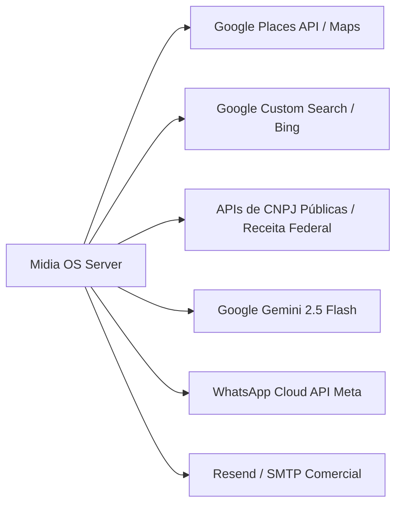

# PROSPECT INTEGRAÇÕES EXTERNAS & ANÁLISE DE CUSTOS
## Mapeamento de APIs, Limites, Requisitos e Estimativas Financeiras
**Módulo:** Midia OS Prospect  

---

## 1. ECOSSISTEMA DE INTEGRAÇÕES EXTERNAS

---

## 2. ANÁLISE DETALHADA POR PROVEDOR

### 2.1. Descoberta de Empresas & Presença Física: Google Places API (New)
- **Função**: Localização de empresas comerciais por raio geográfico, cidade, segmento e categoria.
- **Campos Coletados**: Nome Fantasia, Endereço completo, Telefone comercial, Website oficial, Classificação de categoria, Horário de funcionamento, Avaliações.
- **Políticas e Limites**:
  - Requer chave de API no Google Cloud Console com cobrança ativada.
  - Franquia gratuita: **US$ 200 mensais** de crédito gratuito fornecido pelo Google Cloud.
  - Custo após a franquia:
    - *Text Search (ID Only)*: Gratuito.
    - *Text Search (Basic Data)*: US$ 5,00 por 1.000 requisições.
    - *Place Details (Contact + Atmosphere)*: US$ 17,00 por 1.000 requisições.
- **Estratégia de Otimização**:
  - Cache local de resultados: uma empresa localizada não é pesquisada novamente no Google Places dentro de 30 dias.
  - Utilização de `FieldMask` estrito para requisitar apenas os campos essenciais, reduzindo em até 60% os custos de API.

### 2.2. Pesquisa Web & Detecção de Sinais: Google Custom Search JSON API / Bing Web Search
- **Função**: Busca de sinais de expansão ("inaugura nova loja", "abre filial", "investimento publicitário") e busca de sites institucionais quando o CNPJ não tem domínio.
- **Custos**:
  - Google Custom Search: 100 consultas/dia gratuitas; US$ 5,00 por 1.000 consultas adicionais (máx. 10.000/dia).
  - Bing Web Search: US$ 3,00 a US$ 7,00 por 1.000 requisições (dependendo do tier).
- **Estratégia**:
  - Utilizar prioritariamente as 100 consultas gratuitas diárias para rotinas automáticas de enriquecimento profundo.

### 2.3. Dados Oficiais da Receita Federal & CNPJ
- **Função**: Obtenção de Razão Social, CNAE principal e secundários, Data de Abertura, Situação Cadastral, Inscrições Estadual e Municipal, Bairro e CEP.
- **Serviços Utilizados**:
  1. `BrasilAPI`: 100% gratuita, sem limites estritos, open-source.
  2. `ReceitaWS`: Gratuita (limite de 3 consultas por minuto no plano free).
  3. `publica.cnpj.ws` & `open.cnpja.com`: Fallbacks já implementados no Mídia OS (`src/lib/cnpj.ts`).
- **Custo Operacional**: **R$ 0,00** (usando a infraestrutura de rotação e fallback já testada no Mídia OS).
- **Janela Noturna de Sincronização**: Rotinas de reconciliação em lote executadas no intervalo de 00:01 às 05:55 (conforme já estabelecido no projeto).

### 2.4. Inteligência Artificial: Google Gemini 2.5 Flash
- **Função**:
  - Análise e diagnóstico da empresa prospectada.
  - Cálculo e justificativa da pontuação comercial (Score 0-100).
  - Cruzamento demográfico e geográfico com o catálogo de inventário de mídia.
  - Redação de mensagens personalizadas de abordagem para WhatsApp, E-mail e Roteiro de Ligação.
- **Custos da API Google Gemini**:
  - *Gemini 2.5 Flash*:
    - Entrada (Input): US$ 0,075 por 1.000.000 de tokens.
    - Saída (Output): US$ 0,30 por 1.000.000 de tokens.
  - Custo por Lead Processado (média de 1.500 tokens de prompt + 600 tokens de resposta estruturada JSON):
    $$\text{Custo por Lead} \approx \text{US\$ } 0,00029 \approx \text{R\$ } 0,0017$$
  - Processar 1.000 empresas qualificadas custa apenas aproximadamente **R$ 1,70**.
- **Resiliência / Fallback**:
  - O sistema mantém o algoritmo determinístico de fallback (`gerarEstrategiaHeuristica`) para operar com zero interrupção caso a chave de API esteja indisponível ou ocorra falha de rede temporária.

### 2.5. Mensageria Oficial: WhatsApp Business Cloud API (Meta)
- **Função**: Primeiro contato comercial autorizado para leads com WhatsApp comercial público.
- **Modelo de Cobrança da Meta**:
  - Conversas de Marketing iniciadas pela empresa: ~US$ 0,0625 por conversa no Brasil (janela de 24 horas aberta).
  - Conversas de Serviço iniciadas pelo cliente: ~US$ 0,03.
  - As primeiras 1.000 conversas de serviço mensais por WhatsApp Business Account são gratuitas.
- **Requisito Legal**: Uso obrigatório de templates cadastrados e aprovados pela Meta com identificação do remetente e botão de opt-out.

### 2.6. E-mail Comercial Transacional: Resend / SMTP Corporativo
- **Função**: Envio de apresentações institucionais e e-mails de introdução comercial.
- **Custo**:
  - Plano gratuito Resend: 3.000 e-mails/mês (100/dia).
  - Planos corporativos: US$ 20/mês para até 50.000 e-mails.

---

## 3. TABELA RESUMO DE CUSTOS ESTIMADOS (POR 1.000 LEADS PROCESSADOS)

| Serviço / API | Volume Típico | Custo Estimado (R$) | Estratégia de Mitigação |
| :--- | :--- | :--- | :--- |
| **Google Places (New)** | 1.000 buscas com detalhes | ~R$ 0,00 (Crédito US$ 200/mês) | FieldMask restrito + Cache 30 dias |
| **Google Search / Bing** | 200 enriquecimentos | R$ 0,00 (Cota gratuita diária) | Priorizar buscas sem CNPJ identificado |
| **Receita Federal / CNPJ**| 1.000 consultas | R$ 0,00 | BrasilAPI / ReceitaWS / CNPJ.ws |
| **Google Gemini 2.5 Flash**| 1.000 análises + copys | ~R$ 1,70 | Cache de diagnóstico + Schema enxuto |
| **E-mails Comerciais** | 500 envios | ~R$ 0,00 a R$ 15,00 | Domínio próprio autenticado (SPF/DKIM) |
| **WhatsApp Cloud API** | 200 conversas aprovadas | ~R$ 75,00 | Apenas com opt-in e aprovação prévia |
| **TOTAL ESTIMADO** | **1.000 leads processados**| **~R$ 76,70 a R$ 90,00** | **Menos de R$ 0,10 por lead qualificado** |

