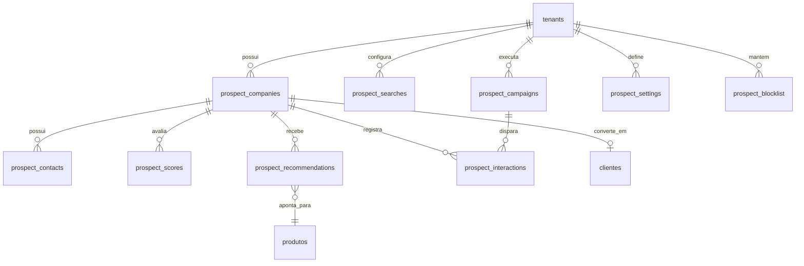

# PROSPECT MODELO DE DADOS
## Especificação do Modelo Relacional, RLS e Índices
**Módulo:** Midia OS Prospect  
**Compatibilidade:** PostgreSQL 15+ / Supabase  

---

## 1. DIAGRAMA ENTIDADE-RELACIONAMENTO (CONCEITUAL)



---

## 2. ESQUEMA DE TABELAS (DDL PROPOSTO)

### 2.1. `public.prospect_settings` (Configurações do Master)
```sql
CREATE TABLE IF NOT EXISTS public.prospect_settings (
    id UUID PRIMARY KEY DEFAULT gen_random_uuid(),
    tenant_id UUID NOT NULL REFERENCES public.tenants(id) ON DELETE CASCADE,
    peso_compatibilidade_midia INTEGER DEFAULT 30,
    peso_segmento_potencial INTEGER DEFAULT 25,
    peso_regiao_cobertura INTEGER DEFAULT 20,
    peso_qualidade_dados INTEGER DEFAULT 15,
    peso_momento_expansao INTEGER DEFAULT 10,
    nivel_autonomia TEXT DEFAULT 'assistido' CHECK (nivel_autonomia IN ('assistido', 'supervisionado', 'automatizado')),
    limite_diario_contatos INTEGER DEFAULT 50,
    horario_inicio_envios TIME DEFAULT '08:30:00',
    horario_fim_envios TIME DEFAULT '18:00:00',
    dias_semana_permitidos INTEGER[] DEFAULT '{1,2,3,4,5}', -- 1=Segunda, 5=Sexta
    created_at TIMESTAMPTZ DEFAULT now(),
    updated_at TIMESTAMPTZ DEFAULT now(),
    CONSTRAINT uq_prospect_settings_tenant UNIQUE(tenant_id)
);
```

### 2.2. `public.prospect_searches` (Histórico e Rotinas de Busca)
```sql
CREATE TABLE IF NOT EXISTS public.prospect_searches (
    id UUID PRIMARY KEY DEFAULT gen_random_uuid(),
    tenant_id UUID NOT NULL REFERENCES public.tenants(id) ON DELETE CASCADE,
    termo_pesquisa TEXT NOT NULL,
    segmento TEXT,
    cidade TEXT,
    estado TEXT,
    raio_km INTEGER,
    modo_busca TEXT DEFAULT 'manual' CHECK (modo_busca IN ('manual', 'automatico_diario')),
    fontes_consultadas TEXT[] DEFAULT '{google_places,receita_federal}',
    total_encontradas INTEGER DEFAULT 0,
    total_novas INTEGER DEFAULT 0,
    total_duplicadas INTEGER DEFAULT 0,
    executado_por UUID REFERENCES public.profiles(id) ON DELETE SET NULL,
    created_at TIMESTAMPTZ DEFAULT now()
);
```

### 2.3. `public.prospect_companies` (Empresas Prospectadas)
```sql
CREATE TABLE IF NOT EXISTS public.prospect_companies (
    id UUID PRIMARY KEY DEFAULT gen_random_uuid(),
    tenant_id UUID NOT NULL REFERENCES public.tenants(id) ON DELETE CASCADE,
    search_id UUID REFERENCES public.prospect_searches(id) ON DELETE SET NULL,
    razao_social TEXT,
    nome_fantasia TEXT NOT NULL,
    cnpj TEXT,
    cnae TEXT,
    segmento TEXT,
    website TEXT,
    instagram TEXT,
    linkedin TEXT,
    facebook TEXT,
    endereco TEXT,
    bairro TEXT,
    cidade TEXT,
    uf TEXT,
    cep TEXT,
    telefone_comercial TEXT,
    whatsapp_comercial TEXT,
    email_comercial TEXT,
    fonte_origem TEXT NOT NULL, -- 'google_places', 'bing', 'receita_federal', 'manual'
    url_fonte TEXT,
    qualidade_dados_score INTEGER DEFAULT 0, -- 0 a 100
    score_comercial_total INTEGER DEFAULT 0, -- 0 a 100
    status TEXT DEFAULT 'descoberto' CHECK (status IN ('descoberto', 'qualificado', 'abordado', 'em_conversa', 'rejeitado', 'convertido_crm', 'bloqueado')),
    executivo_id UUID REFERENCES public.profiles(id) ON DELETE SET NULL,
    cliente_id UUID REFERENCES public.clientes(id) ON DELETE SET NULL,
    dados_brutos JSONB DEFAULT '{}'::jsonb,
    created_at TIMESTAMPTZ DEFAULT now(),
    updated_at TIMESTAMPTZ DEFAULT now()
);

-- Índices essenciais para performance e deduplicação
CREATE INDEX IF NOT EXISTS idx_prospect_comp_tenant ON public.prospect_companies(tenant_id);
CREATE INDEX IF NOT EXISTS idx_prospect_comp_cnpj ON public.prospect_companies(tenant_id, cnpj);
CREATE INDEX IF NOT EXISTS idx_prospect_comp_executivo ON public.prospect_companies(executivo_id);
CREATE INDEX IF NOT EXISTS idx_prospect_comp_status ON public.prospect_companies(status);
```

### 2.4. `public.prospect_contacts` (Decisores e Contatos Públicos)
```sql
CREATE TABLE IF NOT EXISTS public.prospect_contacts (
    id UUID PRIMARY KEY DEFAULT gen_random_uuid(),
    tenant_id UUID NOT NULL REFERENCES public.tenants(id) ON DELETE CASCADE,
    company_id UUID NOT NULL REFERENCES public.prospect_companies(id) ON DELETE CASCADE,
    nome TEXT NOT NULL,
    cargo TEXT,
    departamento TEXT, -- 'marketing', 'comercial', 'diretoria', 'geral'
    email TEXT,
    telefone TEXT,
    linkedin_url TEXT,
    fonte_identificacao TEXT NOT NULL,
    confianca TEXT DEFAULT 'media' CHECK (confianca IN ('alta', 'media', 'baixa')),
    created_at TIMESTAMPTZ DEFAULT now()
);
```

### 2.5. `public.prospect_scores` (Detalhamento do Score Comercial)
```sql
CREATE TABLE IF NOT EXISTS public.prospect_scores (
    id UUID PRIMARY KEY DEFAULT gen_random_uuid(),
    tenant_id UUID NOT NULL REFERENCES public.tenants(id) ON DELETE CASCADE,
    company_id UUID NOT NULL REFERENCES public.prospect_companies(id) ON DELETE CASCADE,
    score_total INTEGER NOT NULL,
    pontos_compatibilidade_midia INTEGER NOT NULL,
    pontos_segmento_potencial INTEGER NOT NULL,
    pontos_regiao_cobertura INTEGER NOT NULL,
    pontos_qualidade_dados INTEGER NOT NULL,
    pontos_momento_expansao INTEGER NOT NULL,
    diagnostico_ia TEXT,
    oportunidades_identificadas JSONB DEFAULT '[]'::jsonb,
    argumentos_comerciais JSONB DEFAULT '[]'::jsonb,
    calculado_em TIMESTAMPTZ DEFAULT now()
);
```

### 2.6. `public.prospect_recommendations` (Produtos Recomendados)
```sql
CREATE TABLE IF NOT EXISTS public.prospect_recommendations (
    id UUID PRIMARY KEY DEFAULT gen_random_uuid(),
    tenant_id UUID NOT NULL REFERENCES public.tenants(id) ON DELETE CASCADE,
    company_id UUID NOT NULL REFERENCES public.prospect_companies(id) ON DELETE CASCADE,
    produto_id UUID REFERENCES public.produtos(id) ON DELETE CASCADE,
    tipo_recomendacao TEXT DEFAULT 'cadastrado_disponivel' CHECK (tipo_recomendacao IN (
        'cadastrado_disponivel',
        'cadastrado_disp_pendente',
        'nao_cadastrado_com_parceiro',
        'nao_cadastrado_expansao'
    )),
    justificativa_ia TEXT NOT NULL,
    pilar_estrategico TEXT DEFAULT 'visibilidade',
    aderencia_percentual INTEGER DEFAULT 80,
    created_at TIMESTAMPTZ DEFAULT now()
);
```

### 2.7. `public.prospect_campaigns` (Campanhas de Primeiro Contato)
```sql
CREATE TABLE IF NOT EXISTS public.prospect_campaigns (
    id UUID PRIMARY KEY DEFAULT gen_random_uuid(),
    tenant_id UUID NOT NULL REFERENCES public.tenants(id) ON DELETE CASCADE,
    nome_campanha TEXT NOT NULL,
    canal TEXT NOT NULL CHECK (canal IN ('whatsapp_oficial', 'email_comercial', 'ligacao_assistida')),
    template_mensagem TEXT NOT NULL,
    assunto_email TEXT,
    aprovada_por_master BOOLEAN DEFAULT false,
    aprovado_em TIMESTAMPTZ,
    status TEXT DEFAULT 'planejada' CHECK (status IN ('planejada', 'em_execucao', 'pausada', 'concluida')),
    created_by UUID REFERENCES public.profiles(id) ON DELETE SET NULL,
    created_at TIMESTAMPTZ DEFAULT now()
);
```

### 2.8. `public.prospect_interactions` (Histórico de Abordagens e Respostas)
```sql
CREATE TABLE IF NOT EXISTS public.prospect_interactions (
    id UUID PRIMARY KEY DEFAULT gen_random_uuid(),
    tenant_id UUID NOT NULL REFERENCES public.tenants(id) ON DELETE CASCADE,
    company_id UUID NOT NULL REFERENCES public.prospect_companies(id) ON DELETE CASCADE,
    campaign_id UUID REFERENCES public.prospect_campaigns(id) ON DELETE SET NULL,
    canal TEXT NOT NULL,
    tipo_evento TEXT NOT NULL CHECK (tipo_evento IN (
        'envio_primeiro_contato',
        'followup_enviado',
        'mensagem_entregue',
        'mensagem_lida',
        'resposta_recebida',
        'demonstrou_interesse',
        'solicitou_reuniao',
        'solicitou_proposta',
        'solicitou_optout',
        'transferido_executivo'
    )),
    conteudo_mensagem TEXT,
    resposta_conteudo TEXT,
    executado_por UUID REFERENCES public.profiles(id) ON DELETE SET NULL,
    created_at TIMESTAMPTZ DEFAULT now()
);
```

### 2.9. `public.prospect_blocklist` (Lista de Bloqueio / Não Contato)
```sql
CREATE TABLE IF NOT EXISTS public.prospect_blocklist (
    id UUID PRIMARY KEY DEFAULT gen_random_uuid(),
    tenant_id UUID NOT NULL REFERENCES public.tenants(id) ON DELETE CASCADE,
    tipo_bloqueio TEXT NOT NULL CHECK (tipo_bloqueio IN ('cnpj', 'dominio', 'telefone', 'email')),
    valor TEXT NOT NULL,
    motivo TEXT,
    bloqueado_em TIMESTAMPTZ DEFAULT now(),
    bloqueado_por UUID REFERENCES public.profiles(id) ON DELETE SET NULL,
    CONSTRAINT uq_blocklist_tenant_valor UNIQUE(tenant_id, tipo_bloqueio, valor)
);
```

---

## 3. POLÍTICAS DE ROW LEVEL SECURITY (RLS)

Todas as tabelas do Prospect possuem isolamento total por tenant e filtragem por carteira para executivos comerciais:

```sql
ALTER TABLE public.prospect_settings ENABLE ROW LEVEL SECURITY;
ALTER TABLE public.prospect_searches ENABLE ROW LEVEL SECURITY;
ALTER TABLE public.prospect_companies ENABLE ROW LEVEL SECURITY;
ALTER TABLE public.prospect_contacts ENABLE ROW LEVEL SECURITY;
ALTER TABLE public.prospect_scores ENABLE ROW LEVEL SECURITY;
ALTER TABLE public.prospect_recommendations ENABLE ROW LEVEL SECURITY;
ALTER TABLE public.prospect_campaigns ENABLE ROW LEVEL SECURITY;
ALTER TABLE public.prospect_interactions ENABLE ROW LEVEL SECURITY;
ALTER TABLE public.prospect_blocklist ENABLE ROW LEVEL SECURITY;

-- Exemplo para prospect_companies:
CREATE POLICY prospect_companies_tenant_policy ON public.prospect_companies
    FOR ALL USING (
        tenant_id = (SELECT tenant_id FROM public.profiles WHERE id = auth.uid())
        AND (
            -- Master e Administradores veem tudo do tenant
            EXISTS (
                SELECT 1 FROM public.user_roles ur 
                WHERE ur.user_id = auth.uid() 
                AND ur.role IN ('admin', 'master_empresa', 'diretoria')
            )
            -- Executivo vê os não assumidos (piscina geral de prospecção) ou os que pertencem à sua carteira
            OR executivo_id IS NULL 
            OR executivo_id = auth.uid()
        )
    );
```

