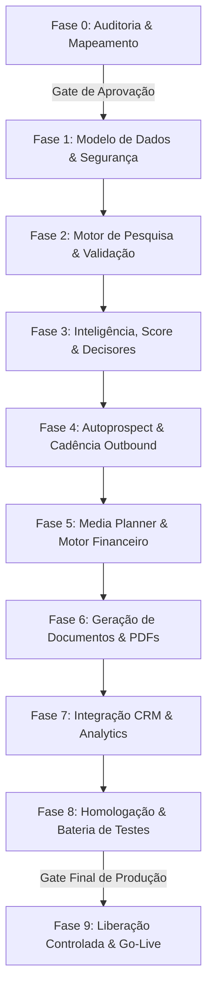

# PROSPECT PLANO DE IMPLEMENTAÇÃO
## Roteiro de Engenharia em Fases Sucessivas (Fase 0 à Fase 9)
**Módulo:** Midia OS Prospect  
**Diretriz:** Execução controlada com aprovação obrigatória por marcos  

---

## CRONOGRAMA GERAL DE FASES

---

## DETALHAMENTO DAS FASES

### FASE 0 — AUDITORIA TÉCNICA E APROVAÇÃO (ESTADO ATUAL)
- **Objetivos**:
  - Mapear código-fonte, tabelas do Supabase, RLS, regras financeiras e APIs de terceiros.
  - Auditar o arquivo `07_massa_dados_ficticios_staging.sql` e documentar a solução para tipos estáticos em blocos `DO $$`.
  - Elaborar a documentação mestra (10 documentos técnicos).
- **Entregável**: Relatórios de auditoria e arquitetura submetidos ao usuário para aprovação expressa.
- **Portão de Saída**: **Aguardando aprovação formal do usuário para iniciar a Fase 1.**

---

### FASE 1 — ESTRUTURA DO PROSPECT (MODELO DE DADOS & RLS)
- **Ações**:
  - Criação da migração SQL com tabelas auxiliares:
    - `prospect_searches`, `prospect_companies`, `prospect_contacts`, `prospect_scores`, `prospect_recommendations`, `prospect_campaigns`, `prospect_interactions`, `prospect_blocklist`, `prospect_settings`.
  - Aplicação rigorosa de Row Level Security (RLS) com checagem de `tenant_id` e carteira (`executivo_id`).
  - Índices de deduplicação (índice único para CNPJ e domínio/tenant).
- **Entregável**: Migração SQL versionada pronta para staging.

---

### FASE 2 — MOTOR DE PESQUISA (PROSPECT)
- **Ações**:
  - Implementação dos serviços de busca manual e automática em `src/lib/prospect-search.functions.ts`.
  - Integração com Google Places API, Google Custom Search e APIs de CNPJ (BrasilAPI/ReceitaWS).
  - Algoritmo de normalização e enriquecimento de dados públicos.
  - Mecanismo anti-duplicidade em tempo real (verifica tanto no Prospect quanto no `public.clientes`).
- **Entregável**: Telas "Central Prospect" e "Buscar Empresas" no frontend.

---

### FASE 3 — INTELIGÊNCIA COMERCIAL (INTELLIGENCE)
- **Ações**:
  - Algoritmo de Pontuação Comercial (Score 0-100) ponderado pelos 5 fatores:
    - Compatibilidade com Inventário (30 pts)
    - Segmento e Potencial (25 pts)
    - Região e Cobertura (20 pts)
    - Qualidade dos Dados (15 pts)
    - Momento / Expansão (10 pts)
  - Pesquisa estruturada de decisores de marketing, sócios e diretores comerciais (sem alucinações, com fonte e nível de confiança).
  - Cruzamento geográfico e demográfico com o catálogo de produtos (`public.produtos`).
- **Entregável**: Componente de dossiê da empresa, diagnóstico de aderência e recomendação de produtos.

---

### FASE 4 — AUTOPROSPECT (PRIMEIRO CONTATO COMERCIAL)
- **Ações**:
  - Motor de cadência com 3 níveis de autonomia:
    - *Modo Assistido*: IA sugere, executivo copia ou clica para enviar.
    - *Modo Supervisionado*: Master aprova lote de mensagens antes do envio.
    - *Modo Automatizado*: Envio programado com limites estritos e horários comerciais.
  - Conexão com canais oficiais (WhatsApp Cloud API e E-mail comercial).
  - Gestão de opt-out (lista de bloqueio automática ao receber "não tenho interesse" ou "descadastrar").
  - Identificação de respostas com transição automática de lead quente para a carteira do executivo.
- **Entregável**: Módulo Autoprospect com painel de campanhas e histórico de interações.

---

### FASE 5 — MEDIA PLANNER (PLANEJAMENTO DE MÍDIA)
- **Ações**:
  - Motor de geração de 3 alternativas: Econômico, Recomendado e Ampliado.
  - Modos de planejamento: Estratégico (orientado a objetivos), Orçamento (orientado a verba teto) e Combinado.
  - Editor interativo para o executivo: adição/remoção de pontos, ajuste de inserções, descontos e acréscimo de produtos parceiros.
  - Cálculo financeiro em conformidade absoluta com `src/lib/calculo-financeiro-midia.ts` (Imposto -> Comissão -> Repasse).
- **Entregável**: Tela do Media Planner integrada à campanha e catálogo real.

---

### FASE 6 — DOCUMENTOS E PDF
- **Ações**:
  - Geração de PDF do **Planejamento Interno** (com detalhamento de custos, comissões e margens).
  - Geração de PDF da **Proposta Comercial Externa** (estratégia, formatos, audiência, investimento sem custos internos).
  - Aplicação do branding visual do tenant (logo, cores corporativas, contatos do executivo).
- **Entregável**: Visualizador e gerador de PDF via `jspdf`.

---

### FASE 7 — CRM E ANALYTICS
- **Ações**:
  - Sincronização automática com a carteira do executivo no CRM.
  - Painel de Indicadores comerciais (empresas encontradas, taxa de resposta, reuniões geradas, planos criados, faturamento originado).
  - Filtros por executivo, segmento, praça e período.
- **Entregável**: Telas "Meus Leads", "Indicadores" e menu completo no `AppShell`.

---

### FASE 8 — HOMOLOGAÇÃO E TESTES
- **Ações**:
  - Suíte automatizada de testes do Prospect adicionada a `tests/`.
  - Verificação de isolamento RLS, cálculos financeiros em centavos, taxas de opt-out e idempotência de buscas.
  - Simulação de testes com massa de dados fictícia em ambiente isolado.
- **Entregável**: Relatório formal de homologação aprovado.

---

### FASE 9 — LIBERAÇÃO E GO-LIVE
- **Ações**:
  - Verificação final de sanidade e segurança.
  - Habilitação da feature flag do Prospect para os tenants autorizados.
  - Disponibilização do manual de uso em `/documentacao`.

