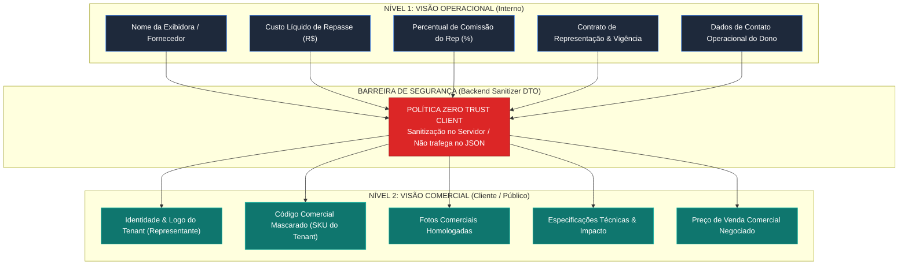
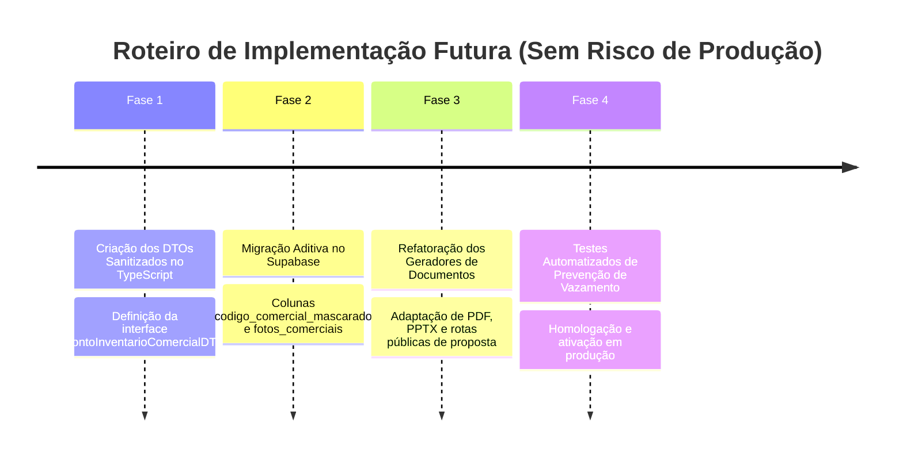

# PLANO ARQUITETURAL: CAMADA DE PROTEÇÃO COMERCIAL DO INVENTÁRIO
## Blindagem de Origem, Desintermediação e Mascaramento White-Label no Mídia.OS

> **Status:** Documento de Planejamento Técnico e Arquitetura (Não Implementado)  
> **Versão:** 1.0  
> **Data:** Outubro de 2026  
> **Objetivo:** Permitir que representantes comerciais comercializem inventários de terceiros com máxima segurança comercial, impedindo o vazamento de parceiros, custos e comissões para clientes externos.

---

## 1. CONTEXTO E O PROBLEMA DA DESINTERMEDIAÇÃO

No modelo de negócios de **Representantes Comerciais e Comercializadoras de Mídia (Modelo 2 do Mídia.OS)**, a principal fortaleza da empresa reside na curadoria do inventário, inteligência estratégica e relacionamento de longo prazo com agências e anunciantes.

### 1.1 O Risco Comercial Crítico
Quando um representante inclui na proposta um ponto de mídia pertencente a uma exibidora terceira parceira ou fornecedor regional, ocorrem dois riscos severos se a origem for exposta:
1. **Desintermediação (Bypass):** O anunciante ou agência descobre qual é a exibidora dona do ponto e passa a cotar diretamente com ela, eliminando o representante do ciclo.
2. **Exposição de Margem (Spread):** Se o cliente tiver acesso ao custo líquido de repasse do parceiro ou ao percentual de comissão, o representante perde poder de negociação e sofre pressão artificial por descontos.

```
                                 [ CENÁRIO INDESEJADO (VAZAMENTO) ]
   Anunciante  ────────(Descobre origem)────────►  Exibidora Terceira (Bypass Comercial)
        ▲                                                │
        │                                                │
        └─── X ─── Representante perde a conta ◄─────────┘

-----------------------------------------------------------------------------------------

                            [ CENÁRIO BLINDADO (CAMADA DE PROTEÇÃO) ]
   Anunciante  ◄────────────────(Visão Comercial Sanitizada)────────────────►  Representante
                                                                                   │
                                (Gestão Operacional Interna Blindada)              │
                                                                                   ▼
                                                                           Exibidora Parceira
```

---

## 2. OS DOIS NÍVEIS DE VISIBILIDADE

A arquitetura define uma barreira estrita e impermeável entre dois contextos de dados:



---

### 2.1 Visão Operacional (Uso Exclusivo Interno)
Destinada aos colaboradores do Tenant com perfil autenticado (*Diretoria*, *Comercial Interno*, *Operações*, *Financeiro*).

* **Entidades e Atributos Visíveis:**
  * Razão Social, CNPJ e Nome Fantasia da Exibidora / Veículo / Fornecedor;
  * ID do Contrato de Representação e termos de exclusividade;
  * Custo líquido de repasse pactuado com o parceiro;
  * Margem bruta de lucro e comissão auferida pelo representante;
  * Contatos operacionais de rua para envio de material gráfico e cobrança de instalação;
  * Relatórios internos de rentabilidade e DRE por parceiro da rede.

---

### 2.2 Visão Comercial (Uso Externo para Clientes e Mercado)
Destinada a apresentações comerciais, propostas digitais, relatórios em PDF/PPTX, portal público de inventário (`/site/inventario`), ambiente de assinatura eletrônica do cliente e relatórios de checking.

* **Entidades e Atributos Visíveis:**
  * **Branding White-Label:** Toda a comunicação ostenta única e exclusivamente a marca, logo, cores e dados do Tenant (Representante);
  * **Identificação Comercial do Ponto (Alias / SKU Próprio):** O código original da exibidora é mascarado (ex: o ponto `EXIB-GO-102` da exibidora terceira é apresentado ao cliente como `NX-DF-042`);
  * **Fotos Comerciais Homologadas:** Curadoria de fotos sem placas de identificação física da exibidora concorrente no rodapé ou na moldura;
  * **Descrição e Métricas de Impacto:** Fluxo de veículos/pedestres, dimensões, formato, geolocalização e praça;
  * **Preço Comercial:** Única e exclusivamente o valor de venda (preço tabela, percentual de desconto concedido e valor líquido final ao anunciante).

---

## 3. REGRA INVIOLÁVEL DE BLINDAGEM (SECURITY INVARIANT)

> 🛡️ **REGRA FUNDAMENTAL DE SEGURANÇA:**  
> **"Nenhum payload de resposta de API pública ou tokenizada, documento gerado (PDF, PPTX), visualizador web ou metadado entregue ao cliente final pode conter referências diretas ou indiretas ao fornecedor original, parceiro, custo de repasse ou percentual de comissão."**

### 3.1 Princípio do "Zero Trust Client"
* **Proibição de Mascaramento em Frontend:** É expressamente proibido enviar dados de custo ou parceiro para o frontend e tentar ocultá-los via CSS (`display: none`), condicionais simples de UI (`{isAdmin && <Custo />}`) ou comentários HTML. Qualquer usuário com o DevTools (F12) aberto interceptaria a resposta de rede.
* **Higienização Obrigatória no Servidor (Server-Side DTO):** A projeção segura deve ser executada nas Server Functions ou nas rotas de API do TanStack Start antes da serialização JSON.

---

## 4. ARQUITETURA TÉCNICA PROPOSTA

### 4.1 Separação de Tipos e DTOs (Data Transfer Objects)

```typescript
// ==========================================
// 1. ENTIDADE INTERNA (Apenas Banco & Backoffice)
// ==========================================
export interface PontoInventarioInterno {
  id: string;
  tenant_id: string;
  origem_inventario: 'PROPRIO' | 'REPRESENTADO';
  rede_no_id?: string;            // ID da exibidora / parceiro (CONFIDENCIAL)
  nome_parceiro?: string;          // Nome da exibidora (CONFIDENCIAL)
  codigo_interno_parceiro?: string;// Código da placa física do dono (CONFIDENCIAL)
  custo_repasse_parceiro: number;  // Custo de compra/repasse (CONFIDENCIAL)
  comissao_representante_pct: number; // Margem (CONFIDENCIAL)
  
  // Dados Comerciais
  codigo_comercial_mascarado: string; // Ex: "NX-OOH-108"
  nome_comercial: string;
  tipo_midia: string;
  preco_tabela: string;
  endereco: string;
  latitude: number;
  longitude: number;
  fotos_comerciais: string[];
  fotos_operacionais: string[];    // Fotos de bastidor, fiação, etc.
}

// ==========================================
// 2. DTO COMERCIAL (Seguro para Clientes / Exportação)
// ==========================================
export interface PontoInventarioComercialDTO {
  id: string;
  codigo_comercial: string;        // Apenas o SKU do Representante
  nome_comercial: string;
  tipo_midia: string;
  endereco_resumido: string;
  bairro: string;
  cidade: string;
  uf: string;
  latitude: number;
  longitude: number;
  dimensoes: string;
  fluxo_estimado: string;
  preco_venda: number;             // Preço autorizado ao cliente
  fotos: string[];                 // Apenas fotos do catálogo comercial
  // OBSERVAÇÃO: NENHUM campo de parceiro, custo ou repasse existe nesta interface!
}
```

---

### 4.2 Pipeline de Mascaramento em 5 Pontos de Contato

```
[ Banco de Dados ] ──► [ Sanitizador Server-Side ] ──┬──► [ 1. Proposta Web / Token ]
                                                     ├──► [ 2. PDF Executivo ]
                                                     ├──► [ 3. PPTX Apresentação ]
                                                     ├──► [ 4. Vitrine /site/inventario ]
                                                     └──► [ 5. Portal Assinatura PI ]
```

| Ponto de Contato | Mecanismo de Blindagem | O que o Cliente Vê |
| :--- | :--- | :--- |
| **1. Propostas Comerciais (Web / Token)** | Server function sanitiza os itens da proposta antes de entregar ao componente público. | Itens listados com código do Representante, foto comercial e preço unitário/total. |
| **2. Gerador de PDF (`proposta-estrategica.ts`)** | Remoção de metadados de `parceiro_id`. Header e Footer com dados 100% white-label do Tenant. | Documento premium com capa, mapa de pontos mascarados e tabela de investimento do anunciante. |
| **3. Gerador de PPTX (`proposta-presentation.ts`)** | Template de slides utiliza apenas campos do `ComercialDTO`. | Apresentação em formato comercial com slides por ativo sem logos de terceiros. |
| **4. Vitrine Pública (`/site/inventario`)** | Endpoint público filtra estritamente por colunas comerciais públicas. | Catálogo interativo para atração de leads com a marca do Representante. |
| **5. Assinatura do PI (`/assinar/$token`)** | Contrato emitido entre Anunciante e Representante. Não cita fornecedores terceiros. | Documento jurídico limpo, detalhando datas, veiculações e valor faturado. |

---

### 4.3 Sistema de Códigos Mascarados (SKU Generator)

Para evitar que o cliente procure o ponto no Google pelo código cadastral da exibidora original, será projetada uma função de geração de SKU comercial com prefixo do inquilino:

$$\text{SKU} = [\text{PREFIXO\_TENANT}] - [\text{UF}] - [\text{TIPO\_MIDIA}] - [\text{SEQUENCIAL}]$$

* Exemplo:
  * Código original da exibidora: `EX-LOTE-44-SUL`
  * Código comercial gerado para o cliente: `NX-DF-LED-0044`

---

### 4.4 Curadoria de Mídia e Fotos (Sanitização Visual)

Muitas fotos de inventário de terceiros possuem a marca d'água da exibidora ou a placa de identificação no rodapé do outdoor/painel.

A arquitetura prevê:
1. **Separação de Galeria:**
   - `fotos_comerciais`: Fotos limpas, com enquadramento focado na publicidade e no fluxo urbano (visíveis ao cliente).
   - `fotos_operacionais`: Fotos técnicas (detalhes da estrutura física, caixa de energia, chassi) utilizadas apenas pela equipe de colagem e manutenção interna.
2. **Flag de Homologação Visual:** Uma foto só é exportada para propostas comerciais após validação humana ou de IA confirmando a inexistência de marcas de concorrentes.

---

## 5. IMPACTO NO SISTEMA ATUAL & ESTRATÉGIA DE ADOÇÃO

### 5.1 O que NÃO será alterado de forma destrutiva
* A tabela `produtos` continua sendo a fonte da verdade para o inventário;
* A tabela `parceiros` continua armazenando os dados contratuais e fiscais dos donos do inventário;
* A emissão de PIs internos e os cálculos de comissão de executivos continuam funcionando exatamente como hoje.

### 5.2 O que será adicionado no futuro (Aditivo e Retrocompatível)
1. **Campos novos na tabela `produtos`:**
   - `codigo_comercial_mascarado` (VARCHAR, gerado automaticamente);
   - `fotos_comerciais` (TEXT[], array de URLs limpas);
   - `mostrar_na_vitrine_publica` (BOOLEAN, default true).
2. **Server Function Sanitizadora (`obterPropostaComercialPublica`):**
   - Criação de uma função de borda dedicada para clientes externos que projeta estritamente o `PontoInventarioComercialDTO`.
3. **Auditoria de Vazamento (Security Tests Automatizados):**
   - Criação de um teste unitário/e2e que simula a requisição de um cliente anônimo e garante via asserção que nenhuma chave como `parceiro`, `custo_repasse`, `comissao` ou `fornecedor` esteja presente nas respostas públicas.

---

## 6. ETAPAS RECOMENDADAS PARA A IMPLEMENTAÇÃO FUTURA



1. **Fase 1 — DTOs & Tipagem Forte:** Declarar no TypeScript os contratos de dados de entrada e saída, impedindo compilação de código que tente vazar campos confidenciais.
2. **Fase 2 — Migração Aditiva no Banco de Dados:** Adicionar colunas com defaults seguros sem impacto nos registros legados.
3. **Fase 3 — Adaptação dos Geradores de PDF/PPTX e Rotas Públicas:** Garantir que as funções `proposta-estrategica.ts` e rotas de visualização pública recebam exclusivamente o DTO comercial.
4. **Fase 4 — Testes de Blindagem:** Executar bateria de testes com payloads públicos para assegurar 100% de confidencialidade comercial antes do go-live.

---

## 7. CONCLUSÃO

A **Camada de Proteção Comercial do Inventário** confere ao Mídia.OS o grau de maturidade necessário para operar como o principal sistema operacional de comercializadoras e representantes de mídia do país. 

Ao blindar fornecedores, custos e comissões através de um design baseado no princípio de **Zero Trust Client** e **Server-Side Data Masking**, a plataforma garante a fidelização da carteira de clientes do representante, protege sua lucratividade e entrega ao anunciante uma experiência profissional e white-label de alto padrão.
