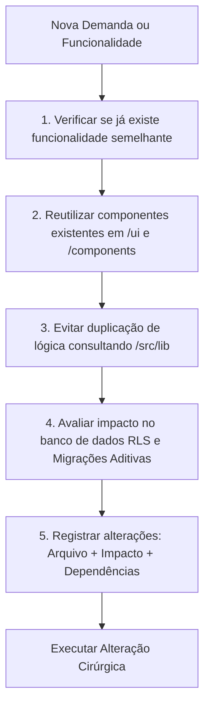

# MEMÓRIA PERMANENTE E CONTEXTO PARA AGENTES DE IA — MÍDIA.OS

> **Arquivo:** `/docs/00_CONTEXT_AI.md`  
> **Classificação:** Diretriz Máxima de Cognição e Engenharia para Agentes de IA  
> **Versão da Plataforma:** 2.6.0 Enterprise Multi-Tenant  
> **Ambiente:** Produção (Política Ativa de Zero Perda de Dados)  
> **Status:** Mandatório para qualquer interação ou alteração de código  

---

## 1. PROPÓSITO DO SISTEMA

O **Mídia.OS** é uma plataforma SaaS *Enterprise Omnichannel* e *White-Label* projetada como o **sistema operacional definitivo do mercado publicitário**, atendendo veículos de comunicação, agências de representação comercial e exibidoras de mídia exterior (OOH, DOOH, TV, Rádio, Mídia Impressa e Digital).

A plataforma centraliza o ciclo operacional completo:
1. **Atração & Qualificação:** CRM Kanban comercial e enriquecimento automático de CNPJs na Receita Federal via BrasilAPI;
2. **Planejamento & Propostas:** Catálogo de mídia georreferenciado, cálculo dinâmico de margens/BV e geração de apresentações editáveis em PPTX e PDF;
3. **Formalização Jurídica:** Emissão de Pedidos de Inserção (PIs) com trava de centavos, workflow de alçadas de aprovação e Central de Assinaturas Digitais com hash SHA-256 e IP;
4. **Execução & Checking:** Comprovação fotográfica de veiculação e monitoramento em tempo real;
5. **Liquidação Financeira:** Contas a pagar/receber, conciliação de faturamento, apuração de comissões e DRE gerencial.

---

## 2. ARQUITETURA OBRIGATÓRIA

Qualquer evolução na base de código deve respeitar rigorosamente a arquitetura estabelecida:

```
CLIENTE (SPA / SSR)
  ├── React 19 + TypeScript 5.8 (Tipagem Estrita)
  ├── Tailwind CSS v4 + Radix UI Primitives (Design System Atômico)
  ├── TanStack Router (File-Based Routing em src/routes)
  └── TanStack Query v5 (Cache Remoto e Sincronização)
           │
           ▼
SERVIDOR ISOMORFO (TanStack Start / Nitro)
  ├── Server Functions (createServerFn em src/lib/*.functions.ts)
  ├── Validação de Entrada Estrita via Zod Schemas
  └── Resolução de Tenant & Sessão (Auth Middleware)
           │
           ▼
BANCO DE DADOS & SERVIÇOS
  ├── PostgreSQL 14.5 gerenciado via Supabase
  ├── Row Level Security (RLS) obrigatório por tenant_id
  ├── Trilha de Auditoria Imutável (auditoria_alteracoes)
  ├── Lixeira Lógica Segura (trash_items)
  └── Google Gemini 2.5 Flash SDK (inferência de IA estritamente no backend)
```

---

## 3. TECNOLOGIAS UTILIZADAS (STACK HOMOLOGADA)

* **Frontend:** React 19, TypeScript 5.8, Tailwind CSS v4, Lucide React, Radix UI;
* **Roteamento & SSR:** TanStack Router + TanStack Start com motor Nitro;
* **Gerenciamento de Estado de Servidor:** TanStack Query v5 (`@tanstack/react-query`);
* **Persistência & Auth:** Supabase (PostgreSQL 14.5, Supabase Auth, Row-Level Security);
* **Inteligência Artificial:** SDK Oficial Google Gemini (`@google/genai`) com modelo `gemini-2.5-flash`;
* **Manipulação de Documentos:** `jspdf` e `jspdf-autotable` (PDFs), `pptxgenjs` (PowerPoint), `xlsx` (Excel);
* **Validação de Schemas:** Zod v3;
* **Build Tooling:** Vite 6 / Bun / Node.js.

---

## 4. CHECKLIST OBRIGATÓRIO ANTES DE CRIAR QUALQUER RECURSO

**PARE E VERIFIQUE:** Antes de escrever código para uma nova tela, tabela, modal ou função, o agente de IA deve obrigatoriamente executar o seguinte protocolo:



1. **Verificar se já existe funcionalidade semelhante:**
   - Consultar [docs/03_MODULES.md](file:///d:/Projetos/Midia.os/docs/03_MODULES.md) e [docs/06_ROUTES_MAP.md](file:///d:/Projetos/Midia.os/docs/06_ROUTES_MAP.md);
   - Buscar arquivos correspondentes no repositório antes de propor novos caminhos.
2. **Reutilizar componentes existentes:**
   - Consultar [docs/07_COMPONENT_SYSTEM.md](file:///d:/Projetos/Midia.os/docs/07_COMPONENT_SYSTEM.md) e o diretório `src/components/ui`;
   - Usar `Dialog`, `Button`, `Table`, `Badge`, `Input` e formulários modais já prontos.
3. **Evitar duplicação de lógica:**
   - Consultar as Server Functions em `src/lib/` ([pi.functions.ts](file:///d:/Projetos/Midia.os/src/lib/pi.functions.ts), [propostas.functions.ts](file:///d:/Projetos/Midia.os/src/lib/propostas.functions.ts), [produtos.functions.ts](file:///d:/Projetos/Midia.os/src/lib/produtos.functions.ts));
   - Nunca reescrever cálculos de centavos, comissões ou regras de desconto em componentes de interface.
4. **Avaliar impacto no banco de dados:**
   - Consultar [docs/04_DATABASE_SCHEMA.md](file:///d:/Projetos/Midia.os/docs/04_DATABASE_SCHEMA.md);
   - Garantir que a alteração seja puramente aditiva (`IF NOT EXISTS`, defaults seguros) e que mantenha o isolamento por `tenant_id` e triggers de auditoria.
5. **Registrar alterações obrigatoriamente:**
   - Toda alteração deve apontar explicitamente:
     * **Arquivo alterado** (caminho completo);
     * **Impacto** (efeitos colaterais em telas ou fluxos);
     * **Dependências** (módulos ou tabelas dependentes).

---

## 5. REGRAS INVIOLÁVEIS CONTRA DUPLICAÇÃO E ERROS DE ENGENHARIA

1. **Nunca criar nova tabela se uma existente atende:**  
   Reutilizar ou estender o modelo relacional de forma aditiva antes de introduzir novas entidades.
2. **Antes de criar componente verificar `/src/components/ui`:**  
   Reaproveitar a biblioteca de primitivos atômicos e componentes compostos existentes.
3. **Antes de criar função verificar `/src/lib`:**  
   Evitar Server Functions concorrentes. Lógica de um domínio deve ser estendida no seu respectivo arquivo `*.functions.ts`.
4. **Não duplicar regras de negócio:**  
   Cálculos financeiros, travas de centavos, alçadas e validações pertencem à camada de serviço no servidor.
5. **Determinismo Financeiro Obrigatório:**  
   A IA nunca realiza cálculo financeiro final. O motor de cálculo determinístico em TypeScript é o único responsável pela matemática monetária.

---

## 6. CUIDADOS CRÍTICOS EM AMBIENTE DE PRODUÇÃO

* **Política de Zero Perda de Dados:** É proibido executar scripts com `DROP TABLE`, `DROP COLUMN`, `TRUNCATE` ou `DELETE` sem filtro estrito de chave primária e tenant.
* **Segurança de Chaves Secretas:** Nenhuma variável de ambiente de serviço (`SUPABASE_SERVICE_ROLE_KEY`, `GEMINI_API_KEY`) pode ser acessada fora do backend (`server/` ou `src/lib/*.functions.ts`).
* **Proteção de Multi-Tenancy:** Toda consulta SQL ou Supabase deve validar ou herdar o filtro `tenant_id = auth.jwt() ->> 'tenant_id'`.

---

## 7. MAPA DE CONSULTA CANÔNICA DA DOCUMENTAÇÃO (`/docs`)

Quando necessitar de aprofundamento específico, consulte o documento exclusivo de cada matéria:

| Arquivo | Matéria Canônica Exclusiva |
|---|---|
| [docs/01_SYSTEM_OVERVIEW.md](file:///d:/Projetos/Midia.os/docs/01_SYSTEM_OVERVIEW.md) | Propósito comercial, dores de mercado e as 6 capacidades da plataforma |
| [docs/02_ARCHITECTURE.md](file:///d:/Projetos/Midia.os/docs/02_ARCHITECTURE.md) | Especificação técnica completa de arquitetura, SSR Nitro e padrões de código |
| [docs/03_MODULES.md](file:///d:/Projetos/Midia.os/docs/03_MODULES.md) | Organização canônica em 4 pilares (/comercial, /operacional, /financeiro, /admin) |
| [docs/04_DATABASE_SCHEMA.md](file:///d:/Projetos/Midia.os/docs/04_DATABASE_SCHEMA.md) | Modelo relacional PostgreSQL, diagrama ER, dicionário de tabelas e colunas |
| [docs/05_BUSINESS_RULES.md](file:///d:/Projetos/Midia.os/docs/05_BUSINESS_RULES.md) | Trava de centavos, alçadas de diretoria, conversão de PI e regras invariantes |
| [docs/06_ROUTES_MAP.md](file:///d:/Projetos/Midia.os/docs/06_ROUTES_MAP.md) | Inventário completo de rotas TanStack Router, parâmetros e tokens externos |
| [docs/07_COMPONENT_SYSTEM.md](file:///d:/Projetos/Midia.os/docs/07_COMPONENT_SYSTEM.md) | Design System, AppShell, modais de negócio e catálogo de componentes |
| [docs/08_AI_PIPELINES.md](file:///d:/Projetos/Midia.os/docs/08_AI_PIPELINES.md) | Integração Gemini 2.5 Flash, extração com JSON Schema e Copiloto Comercial |
| [docs/09_SECURITY_RBAC.md](file:///d:/Projetos/Midia.os/docs/09_SECURITY_RBAC.md) | Row Level Security (RLS), matriz de papéis RBAC e trilha de auditoria |
| [docs/10_ROADMAP.md](file:///d:/Projetos/Midia.os/docs/10_ROADMAP.md) | Planejamento estratégico em 4 fases rumo ao Mídia.OS 3.0 (pDOOH, Fintech) |
| [docs/11_CHANGELOG.md](file:///d:/Projetos/Midia.os/docs/11_CHANGELOG.md) | Histórico de versões SemVer e entregas de engenharia até a v2.6.0 atual |

---

*Mídia.OS — Memória Permanente e Contexto para Agentes de IA © 2026.*
