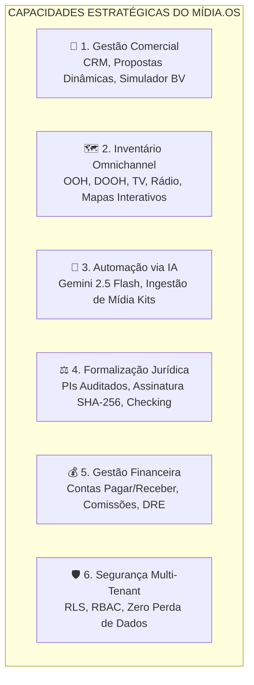

# VISÃO GERAL DO SISTEMA — MÍDIA.OS (v2.6.0)

> **Documento:** 01_SYSTEM_OVERVIEW.md  
> **Classificação:** Documento de Produto e Negócio  
> **Versão da Plataforma:** 2.6.0 Enterprise Multi-Tenant  
> **Status:** Homologado em Produção  

---

## 1. NOME E PROPÓSITO

O **Mídia.OS** é uma plataforma SaaS *Enterprise Omnichannel* e *White-Label* projetada especificamente para a gestão comercial, inteligência operacional, planejamento e formalização de veículos de comunicação, agências de representação comercial e exibidoras de mídia.

A plataforma atua como o sistema operacional definitivo do negócio publicitário, unificando desde a prospecção e montagem de planos de mídia até a emissão formal de Pedidos de Inserção (PIs), checking fotográfico e conciliação financeira.

---

## 2. O PROBLEMA QUE RESOLVE (DORES CRÔNICAS DO MERCADO)

O mercado publicitário (especialmente Mídia Exterior OOH, DOOH, Televisão, Rádio, Mídia Impressa e Painéis Digitais) enfrenta cinco dores estruturais:

1. **Descentralização e Despadronização:** Cada parceiro ou veículo envia mídia kits em formatos totalmente distintos (PDFs pesados, apresentações comerciais em PPTX, planilhas despadronizadas);
2. **Erros em Cálculos e Comissões:** Cálculos manuais de BV (Bonificação de Volume), comissões de executivos, remunerações de agência e rateios entre parceiros geram divergências financeiras recorrentes;
3. **Ciclo Lento de Vendas:** Demora excessiva na montagem de propostas personalizadas e apresentações comerciais para anunciantes;
4. **Insegurança Jurídica e Operacional:** Pedidos de Inserção (PIs) negociados por WhatsApp ou e-mail sem versionamento, carimbo de tempo ou assinatura auditada;
5. **Falta de Conciliação em Tempo Real:** Dificuldade em monitorar o checking de veiculação e o faturamento das campanhas ativas.

---

## 3. PÚBLICO USUÁRIO (STAKEHOLDERS)

1. **Veículos de Comunicação e Exibidoras de OOH/DOOH:** Proprietários de pontos de mídia (outdoors, frontlights, painéis de LED, totens, busdoors, abrigos de ônibus);
2. **Empresas de Representação Comercial de Mídia:** Hubs estratégicos (como a *Nexo Mídia e Representação*) que consolidam o inventário de dezenas de veículos parceiros e vendem pacotes integrados;
3. **Executivos de Contas e Planejadores de Mídia:** Vendedores internos e externos que elaboram planos de mídia, propostas comerciais e simulam descontos;
4. **Diretoria e Controladoria:** Gestores responsáveis pela aprovação de propostas de alto valor, auditoria e margens de lucro;
5. **Agências de Publicidade e Anunciantes/Clientes Finais:** Usuários com acesso a portais de assinatura digital, acompanhamento de PIs, vitrines de inventário e pós-venda;
6. **Instaladores e Equipes de Campo:** Profissionais que realizam a fixação de lonas/adesivos e registram o checking fotográfico de exibição.

---

## 4. AS 6 PRINCIPAIS CAPACIDADES DA PLATAFORMA

* **1. Gestão Comercial:** CRM com funil Kanban, motor de elaboração de propostas comerciais e exportação instantânea para PPTX e PDF. *(Detalhes em [03_MODULES.md](file:///d:/Projetos/Midia.os/docs/03_MODULES.md))*.
* **2. Inventário Omnichannel:** Cadastro, geolocalização em mapa interativo, galeria de fotos e disponibilidade de espaços publicitários em OOH, DOOH, TV, Rádio, Digital e Impresso.
* **3. Automação via IA:** Pipeline com Google Gemini 2.5 Flash para leitura e catalogação autônoma de mídia kits em PDF/Excel e Copiloto Comercial. *(Detalhes em [08_AI_PIPELINES.md](file:///d:/Projetos/Midia.os/docs/08_AI_PIPELINES.md))*.
* **4. Formalização Jurídica:** Ciclo auditado de PIs com trava de centavos, alçadas de diretoria e Central de Assinaturas Digitais com hash SHA-256 e IP. *(Detalhes em [05_BUSINESS_RULES.md](file:///d:/Projetos/Midia.os/docs/05_BUSINESS_RULES.md))*.
* **5. Gestão Financeira:** Contas a pagar/receber, DRE gerencial, conciliação e apuração de comissões por faixa de metas.
* **6. Segurança Multi-Tenant:** Isolamento rigoroso via Row Level Security (RLS), perfis RBAC e política de Zero Perda de Dados. *(Detalhes em [09_SECURITY_RBAC.md](file:///d:/Projetos/Midia.os/docs/09_SECURITY_RBAC.md))*.

---

## 5. STATUS ATUAL DO PROJETO

* **Versão Homologada:** `v2.6.0` (Produção);
* **Regime de Produção:** Política de Zero Perda de Dados ativa (migrações retrocompatíveis, gatilho `auditoria_alteracoes` e tabela `trash_items`);
* **Confiabilidade:** 40 testes automatizados com 100% de aprovação no runner oficial de homologação.

---

*Mídia.OS — Visão Geral do Sistema © 2026.*
