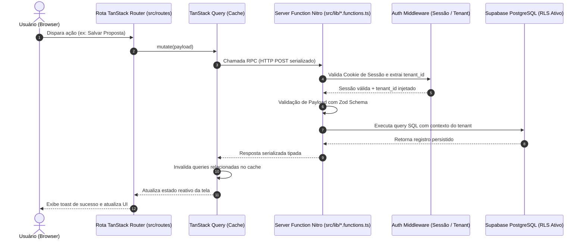

# ARQUITETURA TÉCNICA E FUNCIONAMENTO — MÍDIA.OS (v2.6.0)

> **Documento:** `/docs/02_ARCHITECTURE.md`  
> **Classificação:** Manual de Engenharia e Arquitetura de Software  
> **Objetivo:** Responder com precisão técnica: *"Como o sistema funciona tecnicamente?"*  
> **Status:** Homologado em Produção  

---

## 1. STACK TECNOLÓGICA

| Camada | Tecnologia | Versão | Papel e Justificativa Técnica |
|---|---|---|---|
| **Frontend Core** | React | 19.x | Componentização reativa com concurrent rendering e Actions nativas |
| **Linguagem** | TypeScript | 5.8.x | Tipagem estrita ponta a ponta (cliente, rotas, schemas e banco) |
| **Estilização** | Tailwind CSS | v4.x | Design system atômico com variáveis CSS dinâmicas para White-Label |
| **Primitivos UI** | Radix UI | Latest | Acessibilidade WAI-ARIA, foco retido e dialogs padronizados |
| **Roteamento** | TanStack Router | Latest | File-based routing com validação e tipagem estrita de Search Params |
| **Motor Full-Stack** | TanStack Start + Nitro | Latest | Execução isomorfa (SSR/Edge), compilador Nitro e RPC via Server Functions |
| **Cache & Estado** | TanStack Query | v5.x | Cache assíncrono, mutações com rollback e invalidação cirúrgica |
| **Banco de Dados** | PostgreSQL (Supabase) | 14.5 | SGBD relacional gerenciado com Row Level Security (RLS) nativo |
| **Autenticação** | Supabase Auth | Latest | Gestão de sessões por JWT com claims de `tenant_id` e roles |
| **Inteligência Artificial** | Google Gemini SDK | 2.5 Flash | Modelo multimodal para extração estruturada de mídia e copiloto |
| **Geração de Documentos**| jsPDF / pptxgenjs / xlsx | Latest | Renderização client/server de apresentações PPTX, PDFs e planilhas |
| **Build Tooling** | Vite 6 / Bun / Node | Latest | HMR ultrarrápido e empacotamento otimizado (`scripts/build.mjs`) |

---

## 2. ESTRUTURA DE PASTAS E TOPOLOGIA DO REPOSITÓRIO

```
d:/Projetos/Midia.os/
 ├── docs/                   # Documentação técnica oficial e memória permanente (/docs/00_ a 11_)
 ├── public/                 # Favicons, ícones estáticos e manifest PWA
 ├── scripts/                # Scripts de build incremental (build.mjs) e automações
 ├── server/                 # Configurações de inicialização do motor Nitro e handlers customizados
 ├── supabase/               # Migrações PostgreSQL versionadas (supabase/migrations/) e seeds
 └── src/
      ├── assets/            # Imagens, logotipos vetoriais e ilustrações
      ├── components/        # Componentes reutilizáveis da interface
      │    ├── centralizadores/ # Visualizadores e planejadores 360°
      │    ├── circuitos/       # Gestão de pacotes e circuitos de pontos
      │    ├── parceiros/       # Modais de ingestão e preview de veículos
      │    ├── pi/              # Formulários, grade de veiculação e checkings
      │    ├── proposta/        # Simulador de rentabilidade e gerador de slides
      │    ├── ui/              # Primitivos atômicos do Radix UI estilizados
      │    └── AppShell.tsx     # Shell mestre com navegação dos 4 pilares
      ├── hooks/             # Custom hooks (autenticação, roles, tenant branding)
      ├── integrations/      # Clientes e tipos gerados de serviços externos
      │    └── supabase/     # Client browser/server e database types (types.ts)
      ├── lib/               # Server Functions (createServerFn) e regras de negócio
      │    ├── pi.functions.ts            # Ciclo de vida e trava de centavos do PI
      │    ├── propostas.functions.ts     # Cálculo comercial e conversão de propostas
      │    ├── produtos.functions.ts      # Inventário, mapas e reajustes em lote
      │    ├── inventario-gemini.functions.ts # Extração estruturada com Gemini
      │    └── usuarios.functions.ts      # Gestão de usuários e permissões RBAC
      ├── routes/            # Rotas file-based gerenciadas pelo TanStack Router
      └── types/             # Tipagens globais TypeScript
```

---

## 3. PADRÕES ARQUITETURAIS

### 3.1 Server Functions Isomorfas (`createServerFn`)
* Todas as mutações e consultas críticas operam via `createServerFn({ method: "GET" | "POST" })`;
* Os arquivos em `src/lib/*.functions.ts` atuam como endpoints RPC fortemente tipados;
* **Benefício:** O código do cliente importa a função diretamente, desfrutando de auto-complete e tipagem do retorno, enquanto o runtime executa o corpo exclusivamente no servidor Nitro.

### 3.2 Validação Schema-First com Zod
* Nenhum payload é processado sem validação prévia por esquema Zod (`z.object({...})`);
* Erros de validação interrompem a execução no servidor antes de tocar no banco de dados, retornando mensagens padronizadas.

### 3.3 Resolução Automática de Tenant e Sessão
* O middleware de autenticação (`requireSupabaseAuth`) extrai o cookie de sessão da requisição HTTP;
* O `tenant_id` e o `user_id` são injetados no contexto da Server Function;
* Chamadas com bypass de tenant são rejeitadas com erro de autorização.

### 3.4 Gerenciamento de Estado com TanStack Query
* Leituras utilizam `useQuery` com chaves normalizadas (ex: `['produtos', tenantId, filtros]`);
* Mutações utilizam `useMutation` com `onSuccess` disparando `queryClient.invalidateQueries` seletivo;
* Evita requisições redundantes via políticas configuradas de `staleTime`.

---

## 4. COMUNICAÇÃO FRONTEND / BACKEND



### Tratamento e Padronização de Erros:
* Erros de validação Zod retornam status `400` com mapa de campos inválidos;
* Erros de permissão RBAC retornam status `403` bloqueando a ação;
* Falhas inesperadas registram logs no servidor e retornam mensagens genéricas amigáveis ao cliente, sem expor stack traces sensíveis.

---

## 5. INTEGRAÇÃO COM SERVIÇOS EXTERNOS

```mermaid
flowchart LR
    subgraph BACKEND["BACKEND NITRO (src/lib)"]
        F_IA["inventario-gemini.functions.ts"]
        F_CNPJ["cnpj.ts / pi.functions.ts"]
        F_DRIVE["drive-sync.functions.ts"]
        F_STOR["arquivos.functions.ts"]
    end

    subgraph EXTERNAL["SERVIÇOS EXTERNOS"]
        GEMINI["Google Gemini 2.5 Flash API"]
        BRASIL["BrasilAPI (Receita Federal)"]
        GDRIVE["Google Drive REST API"]
        STORAGE["Supabase Storage (Buckets)"]
    end

    F_IA -->|Prompt + JSON Schema| GEMINI
    F_CNPJ -->|CNPJ 14 dígitos (timeout 6s)| BRASIL
    F_DRIVE -->|OAuth / Service Account| GDRIVE
    F_STOR -->|Upload de fotos e PIs assinados| STORAGE
```

1. **Google Gemini 2.5 Flash:** Chamadas exclusivas pelo backend utilizando o SDK oficial `@google/genai`. Utiliza temperatura `0.1` para extração determinística com validação de JSON Schema;
2. **BrasilAPI (Receita Federal):** Consulta de dados cadastrais por CNPJ encapsulada com `Promise.race` impondo timeout estrito de **6 segundos**;
3. **Google Drive API:** Ingestão de pastas de parceiros para leitura em lote de propostas e planilhas;
4. **Supabase Storage:** Armazenamento seguro de fotos de checking e PDFs de PIs assinados com URLs públicas ou assinadas temporárias.

---

## 6. ESTRATÉGIAS DE SEGURANÇA E CONFORMIDADE

1. **Row Level Security (RLS) Inviolável:**
   - O banco de dados PostgreSQL impõe políticas RLS em todas as tabelas de negócio;
   - Toda operação aplica a trava: `tenant_id = (auth.jwt() ->> 'tenant_id')::uuid`.
2. **Proteção Total de Segredos:**
   - Variáveis sensíveis (`SUPABASE_SERVICE_ROLE_KEY`, `GEMINI_API_KEY`) residem apenas no ambiente do servidor Nitro;
   - O bundle cliente compilado pelo Vite não contém nenhuma referência a credenciais privilegiadas.
3. **Auditoria Universal (`auditoria_alteracoes`):**
   - Gatilhos automáticos registram `INSERT`, `UPDATE` e `DELETE` em tabelas de negócio com snapshots JSONB (`dados_antigos` e `dados_novos`), usuário e timestamp.
4. **Lixeira Segura com Restauração (`trash_items`):**
   - Em conformidade com a política de Zero Perda de Dados, exclusões operam via captura de snapshot integral no banco, permitindo restauração instantânea.

---

*Mídia.OS — Arquitetura Técnica e Funcionamento © 2026.*
