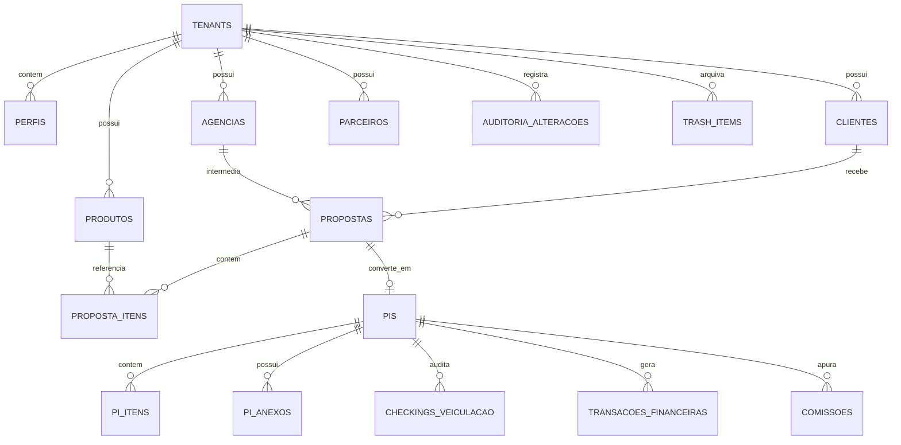

# MODELO DE DADOS E ESQUEMA RELACIONAL — MÍDIA.OS (v2.6.0)

> **Documento:** `/docs/04_DATABASE_SCHEMA.md`  
> **Classificação:** Engenharia de Dados e Banco de Dados  
> **SGBD:** PostgreSQL 14.5 (Supabase gerenciado)  
> **Objetivo:** Responder com precisão técnica: *"Como os dados são estruturados?"*  
> **Status:** Homologado em Produção  

---

## 1. RELACIONAMENTOS E VISÃO GERAL (DIAGRAMA ER)

O modelo relacional do Mídia.OS segue arquitetura hierárquica centrada na entidade `tenants`:



### Cardinalidades e Chaves Estrangeiras Principais:
* `tenants` ➔ 1:N com todas as tabelas de negócio (isolamento por `tenant_id`);
* `clientes` (1) ➔ (N) `propostas` (FK: `propostas.cliente_id`);
* `propostas` (1) ➔ (N) `proposta_itens` (FK: `proposta_itens.proposta_id` com `ON DELETE CASCADE`);
* `propostas` (1) ➔ (1) `pis` (FK bidirecional: `propostas.pi_id` e `pis.proposta_origem_id`);
* `pis` (1) ➔ (N) `pi_itens` (FK: `pi_itens.pi_id` com `ON DELETE CASCADE`);
* `produtos` (1) ➔ (N) `pi_itens` (FK: `pi_itens.produto_id` com `ON DELETE RESTRICT`);
* `pis` (1) ➔ (N) `transacoes_financeiras` (FK: `transacoes_financeiras.pi_id`);
* `pis` (1) ➔ (N) `comissoes` (FK: `comissoes.pi_id`).

---

## 2. TABELAS PRINCIPAIS E CAMPOS IMPORTANTES

### 2.1 Multi-Tenancy e Usuários

#### `tenants`
* `id` *(UUID, PK, gen_random_uuid())*: Identificador global do tenant;
* `nome` *(TEXT, NOT NULL)*: Razão social ou nome fantasia da exibidora;
* `slug` *(TEXT, UNIQUE, NOT NULL)*: Identificador único em URLs;
* `cnpj` *(VARCHAR(18))*: Cadastro de Pessoa Jurídica formatado;
* `branding_config` *(JSONB, DEFAULT '{}')*: Configurações White-Label (logo_url, primary_color, dark_mode);
* `modulos_ativos` *(JSONB, DEFAULT '{"crm": true, "propostas": true, "pi": true, "financeiro": true}')*;
* `created_at` *(TIMESTAMPTZ, DEFAULT now())*.

#### `perfis`
* `id` *(UUID, PK, FK auth.users(id) ON DELETE CASCADE)*: Vínculo ao Auth do Supabase;
* `tenant_id` *(UUID, NOT NULL, FK tenants(id))*: Tenant do usuário;
* `nome_completo` *(TEXT, NOT NULL)*: Nome do operador;
* `email` *(TEXT, NOT NULL, UNIQUE)*: E-mail corporativo;
* `ativo` *(BOOLEAN, DEFAULT true)*: Flag de bloqueio imediato de acesso.

#### `user_roles`
* `id` *(UUID, PK, gen_random_uuid())*;
* `user_id` *(UUID, NOT NULL, FK perfis(id) ON DELETE CASCADE)*;
* `role` *(VARCHAR(50), NOT NULL)*: Papel funcional (`master_admin`, `admin`, `diretor`, `financeiro`, `executivo`, `operacional`, `instalador`).

---

### 2.2 Comercial

#### `clientes`
* `id` *(UUID, PK, gen_random_uuid())*;
* `tenant_id` *(UUID, NOT NULL, FK tenants(id))*: Isolamento por tenant;
* `razao_social` *(TEXT, NOT NULL)*: Nome legal;
* `nome_fantasia` *(TEXT)*: Nome da marca;
* `cnpj` *(VARCHAR(18))*: CNPJ validado (14 dígitos desformatados / formatados);
* `inscricao_estadual`, `inscricao_municipal` *(TEXT)*;
* `endereco`, `cidade`, `uf` *(CHAR(2))*, `cep` *(VARCHAR(10))*;
* `executivo_id` *(UUID, FK perfis(id))*: Vendedor proprietário da conta;
* `situacao_cadastral` *(TEXT)*: Status oficial na Receita Federal (BrasilAPI).

#### `agencias`
* `id` *(UUID, PK, gen_random_uuid())*;
* `tenant_id` *(UUID, NOT NULL, FK tenants(id))*;
* `razao_social` *(TEXT, NOT NULL)*;
* `nome_fantasia`, `cnpj` *(TEXT)*;
* `comissao_padrao` *(NUMERIC(5,2), DEFAULT 20.00)*: Percentual padrão de BV.

#### `propostas`
* `id` *(UUID, PK, gen_random_uuid())*;
* `tenant_id` *(UUID, NOT NULL, FK tenants(id))*;
* `cliente_id` *(UUID, FK clientes(id) ON DELETE RESTRICT)*;
* `agencia_id` *(UUID, FK agencias(id) ON DELETE SET NULL)*;
* `executivo_id` *(UUID, FK perfis(id))*: Responsável pela negociação;
* `campanha` *(TEXT, NOT NULL)*: Título da campanha;
* `status` *(VARCHAR(30), DEFAULT 'rascunho')*: `rascunho`, `enviada`, `aprovada`, `recusada`, `convertida`;
* `valor_tabela` *(NUMERIC(14,2), NOT NULL, DEFAULT 0)*: Soma bruta dos itens;
* `valor_desconto` *(NUMERIC(14,2), DEFAULT 0)*: Total de desconto concedido;
* `valor_negociado` *(NUMERIC(14,2), NOT NULL, DEFAULT 0)*: Valor líquido final;
* `comissao_pct` *(NUMERIC(5,2), DEFAULT 0)*: Alíquota de comissão ou BV;
* `pi_id` *(UUID, FK pis(id) ON DELETE SET NULL)*: PI gerado após conversão.

#### `proposta_itens`
* `id` *(UUID, PK, gen_random_uuid())*;
* `proposta_id` *(UUID, NOT NULL, FK propostas(id) ON DELETE CASCADE)*;
* `produto_id` *(UUID, FK produtos(id) ON DELETE SET NULL)*;
* `tipo` *(VARCHAR(60), NOT NULL)*: Categoria de mídia;
* `formato`, `programa`, `horario` *(TEXT)*;
* `insercoes_dia` *(INTEGER, DEFAULT 1)*;
* `total_insercoes` *(INTEGER, NOT NULL)*;
* `valor_unit` *(NUMERIC(12,2), NOT NULL)*: Preço unitário por inserção/período;
* `valor_negociado` *(NUMERIC(12,2), NOT NULL)*: Subtotal calculado do item.

---

### 2.3 Operacional

#### `produtos` (Inventário Omnichannel)
* `id` *(UUID, PK, gen_random_uuid())*;
* `tenant_id` *(UUID, NOT NULL, FK tenants(id))*;
* `parceiro_id` *(UUID, FK parceiros(id) ON DELETE SET NULL)*: Veículo proprietário;
* `nome` *(VARCHAR(160), NOT NULL)*: Nome de referência do ponto;
* `midia` *(VARCHAR(80), NOT NULL)*: `OOH`, `DOOH`, `TV`, `RÁDIO`, `DIGITAL`, `IMPRESSO`;
* `latitude` / `longitude` *(NUMERIC(10,7))*: Coordenadas validadas para mapas;
* `endereco_ponto`, `sentido_via`, `ponto_referencia` *(TEXT)*;
* `valor_unit` *(NUMERIC(12,2), NOT NULL)*: Preço de tabela;
* `quantidade_telas`, `resolucao`, `tempo_exibicao_segundos` *(Campos DOOH)*;
* `fotos` *(JSONB, DEFAULT '[]')*: Lista de URLs de fotos do ponto;
* `ativo` *(BOOLEAN, DEFAULT true)*: Status de disponibilidade comercial.

#### `parceiros`
* `id` *(UUID, PK, gen_random_uuid())*;
* `tenant_id` *(UUID, NOT NULL, FK tenants(id))*;
* `razao_social` *(TEXT, NOT NULL)*, `nome_fantasia` *(TEXT)*, `cnpj` *(VARCHAR(18))*;
* `comissao_padrao_pct` *(NUMERIC(5,2), DEFAULT 0)*: Percentual de repasse;
* `drive_folder_id` *(TEXT)*: ID de pasta integrada no Google Drive.

#### `pis` (Pedidos de Inserção)
* `id` *(UUID, PK, gen_random_uuid())*;
* `tenant_id` *(UUID, NOT NULL, FK tenants(id))*;
* `numero_pi` *(TEXT, NOT NULL)*: Código sequencial no padrão `PI-{ANO}-{SEQ}`;
* `proposta_origem_id` *(UUID, FK propostas(id) ON DELETE RESTRICT)*;
* `valor_bruto` *(NUMERIC(14,2), NOT NULL)*;
* `valor_liquido` *(NUMERIC(14,2), NOT NULL)*;
* `status_aprovacao` *(VARCHAR(30), DEFAULT 'pendente')*: `pendente`, `aprovado_diretoria`, `reprovado`;
* `status_faturamento` *(VARCHAR(30), DEFAULT 'a_faturar')*: `a_faturar`, `faturado`, `cancelado`;
* `token_aprovacao` *(UUID, DEFAULT gen_random_uuid())*: Token para link direto de aprovação;
* `hash_assinatura_sha256` *(TEXT)*: Hash criptográfico da assinatura digital;
* `pi_origem_id` *(UUID, FK pis(id) ON DELETE RESTRICT)*: Ponteiro para PI anterior em caso de substituição.

#### `pi_itens`
* `id` *(UUID, PK, gen_random_uuid())*;
* `pi_id` *(UUID, NOT NULL, FK pis(id) ON DELETE CASCADE)*;
* `produto_id` *(UUID, NOT NULL, FK produtos(id) ON DELETE RESTRICT)*;
* `data_inicio` *(DATE, NOT NULL)*, `data_fim` *(DATE, NOT NULL)*;
* `quantidade` *(INTEGER, NOT NULL)*;
* `valor_negociado` *(NUMERIC(14,2), NOT NULL)*: Valor com trava de centavos.

#### `checkings_veiculacao`
* `id` *(UUID, PK, gen_random_uuid())*;
* `pi_item_id` *(UUID, NOT NULL, FK pi_itens(id) ON DELETE CASCADE)*;
* `foto_url` *(TEXT, NOT NULL)*: URL no Supabase Storage;
* `latitude` / `longitude` *(NUMERIC(10,7))*: Coordenadas GPS da coleta;
* `coletado_em` *(TIMESTAMPTZ, DEFAULT now())*.

---

### 2.4 Financeiro

#### `transacoes_financeiras`
* `id` *(UUID, PK, gen_random_uuid())*;
* `tenant_id` *(UUID, NOT NULL, FK tenants(id))*;
* `pi_id` *(UUID, FK pis(id) ON DELETE SET NULL)*;
* `tipo` *(VARCHAR(10), NOT NULL)*: `receita` ou `despesa`;
* `valor` *(NUMERIC(14,2), NOT NULL)*;
* `data_vencimento` *(DATE, NOT NULL)*, `data_pagamento` *(DATE)*;
* `status` *(VARCHAR(20), DEFAULT 'aberto')*: `aberto`, `pago`, `cancelado`.

#### `comissoes`
* `id` *(UUID, PK, gen_random_uuid())*;
* `tenant_id` *(UUID, NOT NULL, FK tenants(id))*;
* `pi_id` *(UUID, NOT NULL, FK pis(id) ON DELETE CASCADE)*;
* `executivo_id` *(UUID, NOT NULL, FK perfis(id) ON DELETE RESTRICT)*;
* `percentual` *(NUMERIC(5,2), NOT NULL)*;
* `valor_comissao` *(NUMERIC(12,2), NOT NULL)*;
* `status` *(VARCHAR(20), DEFAULT 'a_pagar')*: `a_pagar`, `paga`, `estornada`.

---

### 2.5 Auditoria e Lixeira

#### `auditoria_alteracoes`
* `id` *(BIGSERIAL, PK)*;
* `tenant_id` *(UUID, NOT NULL)*;
* `tabela` *(TEXT, NOT NULL)*;
* `operacao` *(VARCHAR(10), NOT NULL)*: `INSERT`, `UPDATE` ou `DELETE`;
* `usuario_id` *(UUID)*;
* `dados_antigos` *(JSONB)*;
* `dados_novos` *(JSONB)*;
* `created_at` *(TIMESTAMPTZ, DEFAULT now())*.

#### `trash_items`
* `id` *(UUID, PK, gen_random_uuid())*;
* `tenant_id` *(UUID, NOT NULL)*;
* `tabela_origem` *(TEXT, NOT NULL)*;
* `registro_id` *(UUID, NOT NULL)*;
* `snapshot` *(JSONB, NOT NULL)*;
* `motivo` *(TEXT)*;
* `deleted_by` *(UUID)*;
* `created_at` *(TIMESTAMPTZ, DEFAULT now())*.

---

## 3. REGRAS DE INTEGRIDADE RELACIONAL

1. **Chaves Primárias (PK):** Padronizadas em UUID v4 geradas por `gen_random_uuid()` (exceto `auditoria_alteracoes` que usa `BIGSERIAL` para ordenação cronológica);
2. **Proteção Contra Órfãos (`ON DELETE RESTRICT`):** Não é permitido deletar clientes, parceiros ou produtos que possuam PIs ou propostas atreladas;
3. **Deleção em Cascata Segura (`ON DELETE CASCADE`):** Aplicada apenas em tabelas dependentes filhas (`proposta_itens`, `pi_itens`, `checkings_veiculacao`) mediante exclusão da entidade pai autorizada;
4. **Precisão Monetária Estrita:** Valores financeiros sempre utilizam `NUMERIC(14,2)` ou `NUMERIC(12,2)` para evitar erros de ponto flutuante;
5. **Índices de Performance Obrigatórios:**
   - Índice composto `(tenant_id, id)` em todas as tabelas de negócio;
   - Índice em chaves estrangeiras (`proposta_id`, `pi_id`, `cliente_id`, `produto_id`);
   - Índice único `(tenant_id, numero_pi)` na tabela `pis`.

---

## 4. MULTI-TENANCY E ROW-LEVEL SECURITY (RLS)

O isolamento multi-tenant é aplicado diretamente no motor PostgreSQL via políticas RLS ativas:

```sql
-- Exemplo de política padrão de isolamento aplicada a cada tabela de negócio
ALTER TABLE public.propostas ENABLE ROW LEVEL SECURITY;

CREATE POLICY "tenant_isolation_select" ON public.propostas
    FOR SELECT
    USING (tenant_id = (auth.jwt() ->> 'tenant_id')::uuid);

CREATE POLICY "tenant_isolation_insert" ON public.propostas
    FOR INSERT
    WITH CHECK (tenant_id = (auth.jwt() ->> 'tenant_id')::uuid);

CREATE POLICY "tenant_isolation_update" ON public.propostas
    FOR UPDATE
    USING (tenant_id = (auth.jwt() ->> 'tenant_id')::uuid)
    WITH CHECK (tenant_id = (auth.jwt() ->> 'tenant_id')::uuid);
```

* **Garantia de Isolamento:** Mesmo em queries sem cláusula `WHERE tenant_id = ...`, o PostgreSQL intercepta a consulta e filtra estritamente as linhas pertencentes ao `tenant_id` contido no token JWT da sessão autenticada.

---

*Mídia.OS — Modelo de Dados e Esquema Relacional © 2026.*
