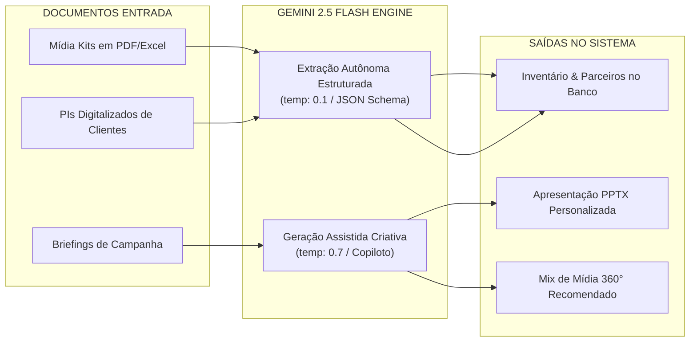

# PIPELINES DE INTELIGÊNCIA ARTIFICIAL — MÍDIA.OS (v2.6.0)

> **Documento:** 08_AI_PIPELINES.md  
> **Classificação:** Engenharia de Inteligência Artificial e Automação  
> **Modelo Oficial:** Google Gemini 2.5 Flash (`@google/genai`)  
> **Status:** Homologado em Produção  

---

## 1. VISÃO GERAL DA CAMADA DE IA

O Mídia.OS utiliza o modelo **Gemini 2.5 Flash** para acelerar processos de alta fricção no mercado publicitário, operando em duas frentes complementares:

---

## 2. PIPELINES DE EXTRAÇÃO AUTÔNOMA

### 2.1 Ingestão de Mídia Kits Despadronizados (`midia-kit-ai.functions.ts`)
* **Desafio:** Exibidoras e veículos enviam apresentações comerciais em PDFs pesados e diagramações heterogêneas.
* **Processamento:**
  - Extrai dados cadastrais do parceiro (razão social, CNPJ, contatos);
  - Extrai linhas de produtos (nome do ponto, tipo de mídia, formato, dimensões, preços de tabela);
  - Valida o payload resultante com esquema Zod antes de persistir no banco de dados.

### 2.2 Extração em Lote de Inventário com JSON Schema (`inventario-gemini.functions.ts`)
* **Parâmetros:**
  - `model`: `"gemini-2.5-flash"`
  - `temperature`: `0.1` (determinística, para minimizar desvios numéricos);
  - `responseMimeType`: `"application/json"`;
  - `responseSchema`: JSON Schema estrito com campos obrigatórios.
* **Metadados Inferidos:** Coordenadas aproximadas de geolocalização (`latitude`, `longitude`), sentido da via, fluxo de veículos/dia e métricas técnicas de DOOH.

### 2.3 Reconhecimento de PIs de Agências (`pi-ai.functions.ts`)
* Processa pedidos de inserção emitidos por outros sistemas para importação direta de períodos e valores contratados.

---

## 3. PIPELINES DE GERAÇÃO ASSISTIDA

### 3.1 Copiloto Comercial IA (`copiloto-comercial.functions.ts`)
* **Interface:** Chat interativo disponível para executivos de contas;
* **Contexto Injetado:** Inventário ativo do tenant, verba disponível do cliente e histórico de sucesso no segmento;
* **Capacidades:** Sugere mix de pontos, argumentos comerciais e calcula simulações preliminares de margem.

### 3.2 Planejamento e Estratégia 360° (`estrategia-ia.functions.ts`)
* Formula a divisão percentual ideal de verba entre OOH, DOOH, TV, Rádio e Digital de acordo com o objetivo da campanha (alcance, frequência ou branding).

### 3.3 Copywriting para Apresentações Comerciais (`proposta-apresentacao.functions.ts`)
* Redige textos persuasivos para os slides da proposta em PowerPoint (`PPTX`): sumário executivo, impacto de audiência e condições contratuais.

---

## 4. PARÂMETROS OPERACIONAIS E GOVERNANÇA

| Parâmetro | Extração Autônoma | Geração Assistida |
|---|---|---|
| **Modelo** | `gemini-2.5-flash` | `gemini-2.5-flash` |
| **Temperatura** | `0.0` a `0.1` | `0.6` a `0.7` |
| **Formato de Saída** | JSON Schema Estrito | Texto / JSON Estruturado |
| **Timeout de Servidor** | 25 segundos | 25 segundos |
| **Retentativa** | 1x com prompt corretivo | 1x |
| **Fallback** | Formulário manual disponível | Resposta padrão assistida |

---

## 5. SEGURANÇA E PRIVACIDADE DE DADOS

1. **Credenciais Ocultas:** A chave `GEMINI_API_KEY` reside exclusivamente no ambiente de servidor do Nitro, nunca acessível pelo navegador;
2. **Determinismo Financeiro:** O modelo nunca calcula ou aprova o valor final do PI por conta própria;
3. **Privacidade (LGPD):** Dados bancários completos e senhas jamais são trafegados nos prompts da API.

---

*Mídia.OS — Pipelines de Inteligência Artificial © 2026.*
