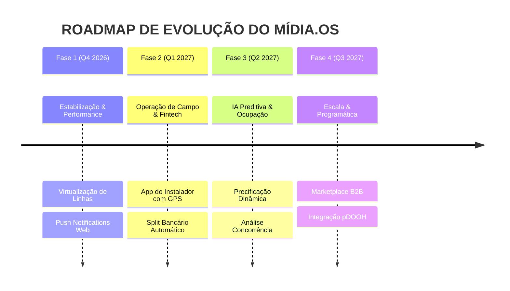

# ROADMAP ESTRATÉGICO DE EVOLUÇÃO — MÍDIA.OS (v2.6 ➔ v3.0)

> **Documento:** 10_ROADMAP.md  
> **Classificação:** Planejamento Estratégico e Engenharia de Produto  
> **Horizonte:** 2026 - 2027  
> **Status:** Ativo  

---

## 1. VISÃO ESTRATÉGICA

O ciclo de evolução do **Mídia.OS** tem como objetivo transformar a plataforma em um ecossistema transacional inteligente de mídia, conectando anunciantes, exibidoras e a operação de campo em tempo real com automação bancária e integração programática (pDOOH).

---

## 2. DETALHAMENTO DAS FASES DO ROADMAP

### Fase 1: Estabilização, Ergonomia & Alta Performance (Q4 2026)
* **Virtualização de Tabelas (`@tanstack/react-virtual`):** Otimizar a listagem de produtos e PIs para suportar inventários superiores a 50.000 pontos sem lentidão;
* **Notificações Web Push:** Alertas instantâneos no navegador para executivos quando a diretoria aprovar ou recusar um PI;
* **Otimização de Cache:** Refinamento dos tempos de revalidação no TanStack Query com invalidação granular.

### Fase 2: Operação de Campo & Automação Fintech (Q1 2027)
* **Portal/App do Instalador OOH:** Interface mobile simplificada para equipes de colagem com captura de fotos com coordenadas GPS validadas na câmera;
* **Split Bancário Automático:** Integração direta via BaaS/Open Finance para rateio automático de pagamentos entre exibidora, parceiros e agência (BV).

### Fase 3: Inteligência Artificial Preditiva (Q2 2027)
* **Precificação Dinâmica de Inventário:** Algoritmo de sugestão de preços com base na taxa de ocupação da cidade, sazonalidade e antecedência da veiculação;
* **Simulador de Concorrência:** Monitoramento histórico de campanhas para sugerir pacotes direcionados a segmentos específicos de anunciantes.

### Fase 4: Expansão Comercial e Mídia Programática pDOOH (Q3 2027)
* **Marketplace B2B de Mídia Exterior:** Vitrine pública onde agências compram espaços ociosos diretamente com reserva imediata;
* **Conector Programático pDOOH:** Integração OpenRTB conectando as telas digitais de LED da plataforma às principais DSPs do mercado.

---

## 3. MATRIZ DE ESFORÇO E IMPACTO

| Iniciativa | Complexidade Técnica | Impacto no Negócio | Previsão |
|---|:---:|:---:|:---:|
| **Virtualização de Linhas no Inventário** | Média | Alto | Q4 2026 |
| **Push Notifications Web** | Baixa | Médio | Q4 2026 |
| **Portal do Instalador com GPS Validado** | Média | Altíssimo | Q1 2027 |
| **Split Bancário Automático de Pagamentos** | Alta | Altíssimo | Q1 2027 |
| **Precificação Dinâmica por Taxa de Ocupação** | Alta | Alto | Q2 2027 |
| **Integração Nativa Programática (pDOOH)** | Muito Alta | Disruptivo | Q3 2027 |

---

*Mídia.OS — Roadmap Estratégico de Evolução © 2026.*
